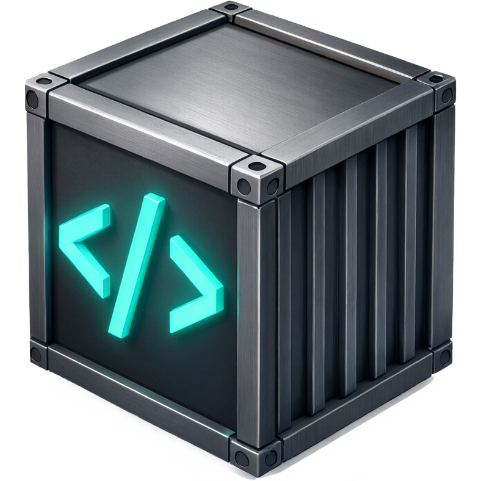
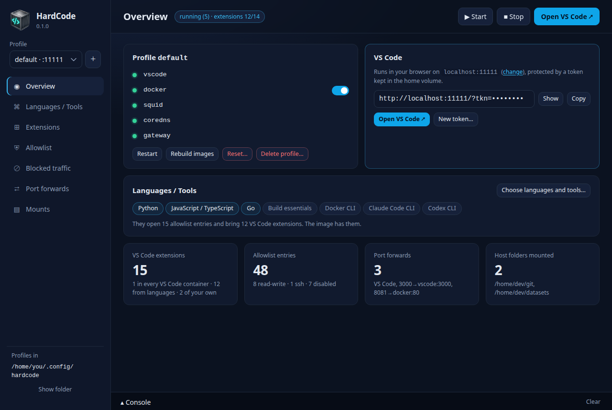

<p align="center">
  
</p>

<h1 align="center">HardCode</h1>

<p align="center">
  <strong>Sandboxed development environments for you and your AI coding agents.</strong><br>
  VS Code in the browser, Claude Code and Codex, a Docker daemon of its own,<br>
  and an internet allowlist enforced by an inspecting proxy.
</p>

<p align="center">
  <a href="https://github.com/hardcode-app/hardcode/actions/workflows/ci.yml"></a>
  <a href="https://github.com/hardcode-app/hardcode/releases"></a>
  
  
  
  <a href="LICENSE"></a>
  <a href="https://www.conventionalcommits.org"></a>
</p>



AI coding agents, the packages they install and the extensions in your
editor all run with your credentials and your network. With supply-chain
attacks as common as they are, one rogue dependency or extension is all it
takes to read your keys and send them off. HardCode gives them a box
instead: a full development environment in containers, away from your
machine's files and secrets, where nothing leaves unless you've allowed it,
whether by HTTP, HTTPS or a DNS lookup.

There are three ways to run it:

- **The desktop app**, for Linux, macOS and Windows: your sandboxes, their
  allowlists and what they tried to reach, a click away.
- **The `hardcode` command**, a single file, for your terminal and your
  scripts.
- **For teams, on Kubernetes**: a Helm chart with an operator that runs
  everyone's sandboxes in your cluster, and an admin UI to manage them.

## Features

- **An allowlist for the internet.** HTTPS is inspected, so rules apply to
  full URLs and methods: `github.com/your-org` can be cloned but not pushed
  to unless you say `rw`, and nothing else on GitHub is reachable.
- **No way out through DNS either.** The sandbox's only nameserver looks up
  the names you've allowed and answers every other name itself, so a lookup
  such as `<your-key>.attacker.example` never leaves: DNS exfiltration is
  shut off along with HTTP.
- **Rogue packages and extensions stay in the box.** A compromised npm, PyPI
  or crates.io release runs inside the sandbox, not on your machine: it
  can't read your SSH keys or cloud credentials, and it can send what it
  finds only where you've allowed. VS Code extensions come only from
  Marketplace publishers with a verified domain, and so does everything
  they pull in.
- **Built around your languages.** Python, JavaScript/TypeScript, Java,
  Android, C#/.NET, Go, Rust, C/C++, Ruby and Perl: each one you switch on
  installs its toolchain, opens its package registries (read-only) and
  brings its VS Code extensions.
- **Coding agents ready to go.** Claude Code and Codex, installed and working
  through the proxy.
- **Docker inside.** A rootless Docker daemon per sandbox, behind the same
  allowlist: containers you start can't get around it.
- **Profiles.** Separate environments side by side, each with its own
  languages, allowlist, ports, mounts and volumes.
- **See what was blocked.** Every refused request, with one click to allow
  it.

## Quick start

You need Docker Engine 28 or newer with Compose (Docker Desktop on macOS and
Windows), on amd64 or arm64.

**The desktop app:** download the installer for your platform from
[Releases](https://github.com/hardcode-app/hardcode/releases) (`.deb`, `.rpm`,
AppImage, `.dmg`, `.msi` or `.exe`). It asks what your first profile is built
around; then *Start*, and *Open VS Code*. It brings the `hardcode` command
with it, and offers new releases as they come out.

**The command line:** download `hardcode` for your platform from
[Releases](https://github.com/hardcode-app/hardcode/releases), or install it
with Python 3.9+ (`pipx install hardcode_cli-<version>-py3-none-any.whl`), then:

```sh
hardcode up      # asks which languages and tools your first profile has, builds it and starts it
hardcode open    # VS Code, in your browser
```

The first build takes a few minutes for one language. VS Code runs at
`http://localhost:11111`, behind a token that `hardcode open` adds for you.

## Using it

```sh
hardcode allow github.com/your-org            # clone and pull from your organisation
hardcode allow github.com/your-org/app rw     # ...and push to one repository
hardcode blocked                              # what the sandbox tried to reach and couldn't

hardcode enable rust                          # a language: toolchain, registries, extensions
hardcode mount ~/Git git                      # your code, at ~/git in the sandbox
hardcode forward 3000                         # a dev server, at localhost:3000

hardcode profile add api --lang python,docker # another environment, alongside
hardcode -p api up
```

A mounted folder is shared with the sandbox both ways: anything inside can
change files your machine later runs (`.git/hooks`, build scripts). Mount
read-only (`--ro`) what you only need to read.

Everything here is also in the app, along with the extensions, the
allowlist entry by entry, container logs and the console.

## Kubernetes

For a team, the Helm chart installs an operator that turns `Profile`
resources into sandboxes, and an admin UI (sign-in with TOTP) to manage
them:

```sh
helm install hardcode oci://ghcr.io/hardcode-app/charts/hardcode --version <version> \
  --namespace hardcode --create-namespace \
  --set admin.email=you@example.com --set admin.password=<password>
```

See [Kubernetes](docs/kubernetes.md) and [the admin UI](docs/admin.md).

## Security

What HardCode enforces, and what it doesn't, is set out in the
[security model](docs/security.md): read its *Not covered* section before you
rely on it. [Staying safe](docs/staying-safe.md) turns it into habits: how to
use HardCode so that you stay protected. Found a way out of the sandbox? Please report it privately,
through this repository's *Security* tab, rather than in an issue.

## Documentation

- [Getting started](docs/getting-started.md): installing and the first sandbox
- [Profiles](docs/profiles.md) and [the allowlist](docs/allowlist.md)
- [GitHub from the sandbox](docs/github.md): one repository, one token
- [The desktop app](docs/app.md) and [the `hardcode` command](docs/cli.md)
- [Inside the sandbox](docs/vscode-image.md): languages, tools, extensions, Docker inside
- [Architecture](docs/architecture.md) and [troubleshooting](docs/troubleshooting.md)

The full index is [docs/README.md](docs/README.md).

## Building from source

Everything builds in an Ubuntu 26.04 container: Docker is all you need.

```sh
git clone https://github.com/hardcode-app/hardcode.git
cd hardcode
cli/hardcode up          # the command, straight from the checkout
app/build.sh bundle      # the desktop app's installers
```

[Development](docs/development.md) has the layout and conventions, and
[AGENTS.md](AGENTS.md) the ground rules for changes, whoever makes them.

## Licence

HardCode is free software, under the
[GNU Affero General Public License, version 3](LICENSE) only
(AGPL-3.0-only): you may use, change and share it. If you change it and
let others use your version over a network, as a hosted service for
instance, you must offer them its source.
