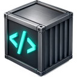

# HardCode app



The desktop control panel, for Linux, macOS and Windows: a [Tauri](https://tauri.app)
window over the `hardcode` command. Everything the window does is one CLI
invocation (`hardcode --json …`), so the app has no logic of its own and the
CLI's tests cover it.

- **Profiles**: a switcher in the sidebar, *New profile* (from the template
  or as a copy of any profile; a free port and subnet are picked), delete.
- **Overview**: container status, start / stop / restart / rebuild / reset,
  the VS Code URL with its token, and an *Open VS Code* button.
- **Allowlist**: every entry of the profile's allowlist, those HardCode
  provides by block and then its own, with search and filters; toggle, add
  (validated) and delete (its own), each applied to the proxy at once;
  *Reload proxy* after a hand edit.
- **Blocked traffic**: what the proxy and the DNS filter refused recently,
  aggregated by target, with *Allow host* / *Allow URL* shortcuts.
- **Port forwards** and **Mounts**: the profile's `compose.override.yaml`;
  applied immediately when the sandbox is running.
- **Languages**: toggle `INSTALL_<LANG>` in the profile's `.env`, then rebuild.
- **All profiles**: the allowlist, mounts and languages views have a scope
  switch, so one change can go to every profile at once.

Long operations stream the CLI's output into the console drawer. A
release's app offers the next release in the sidebar, and installs it,
signed, when asked ([../docs/releasing.md](../docs/releasing.md#the-apps-updater)).

## How it finds the CLI

In order: `$HARDCODE_CLI` (a program, optionally with arguments, e.g.
`python3 /path/cli/hardcode`), a `hardcode` binary bundled next to the app
(releases ship the PyInstaller build as a Tauri sidecar), or
for a development build, `python3 cli/hardcode` in the checkout it was
built from. The profiles are in HardCode's home (`~/.config/hardcode` on
Linux); `hardcode-app --config DIR` passes another folder on to the CLI.

## Build

In the **build image** (`images/build/Dockerfile`), like everything in this
repository: Ubuntu 26.04's rustc/cargo and Tauri's libraries, a pinned
Tauri CLI and PyInstaller. Nothing is installed on the workstation; Docker
is all it needs. `app/build.sh` runs each step in the image, memory-capped,
with the caches in `~/.cache/hardcode-build`:

```sh
app/build.sh build      # the debug binary
app/build.sh bundle     # the hardcode CLI as the app's sidecar + installers: .deb, .rpm, AppImage;
                        # then, on a Linux desktop, the launcher
app/build.sh desktop    # a launcher for the release build in your app grid, with its icon (Linux)
app/build.sh cli        # just the standalone CLI binary -> dist/hardcode-linux-x64
app/build.sh wheel      # the CLI's Python package, with its stack -> dist/hardcode_cli-<version>-py3-none-any.whl
app/build.sh shell      # a shell in the image
```

Start the release build from the launcher (HardCode in the app grid) rather
than from a terminal: GNOME shows an app's icon in the dock only when it can
match the window to an installed `.desktop` file.

`tests/app.py` tests it: the Rust unit tests, a build, and a headless
launch that renders every view against the real CLI. The first run builds
the image and compiles Tauri (a few minutes); later runs take seconds. Installers land in `app/src-tauri/target/release/bundle/`
(the AppImage step downloads `linuxdeploy` once into the cache). The app
isn't run from the container, since it drives Docker on the machine it runs
on: install the `.deb` or run the AppImage. The release workflow builds the
same thing in the same image for Linux, and natively for macOS and Windows.

## Layout

```
src/index.html, app.js, styles.css   the page (no framework, no build step)
src/bridge.js                        window.hardcode: page calls -> hardcode --json
src-tauri/src/lib.rs                 find the CLI, run it, stream output; settings; --smoke
src-tauri/tauri.conf.json            window, CSP, bundle; tauri.release.conf.json adds the sidecar
src-tauri/capabilities/default.json  what the page may call: dialogs and opening URLs
src-tauri/icons/                     generated from assets/hardcode.png
```

The full documentation, with screenshots of every view, is in [docs/app.md](../docs/app.md).
