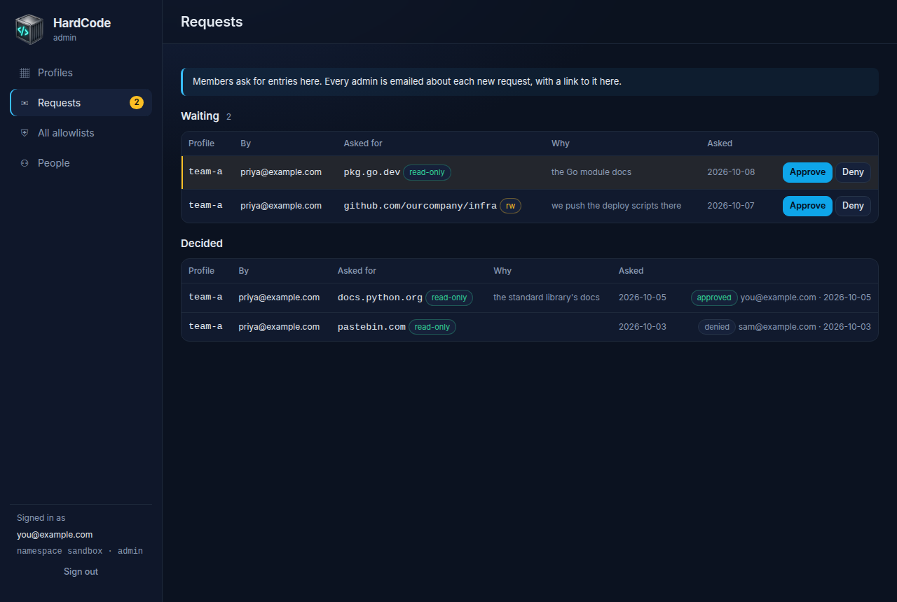
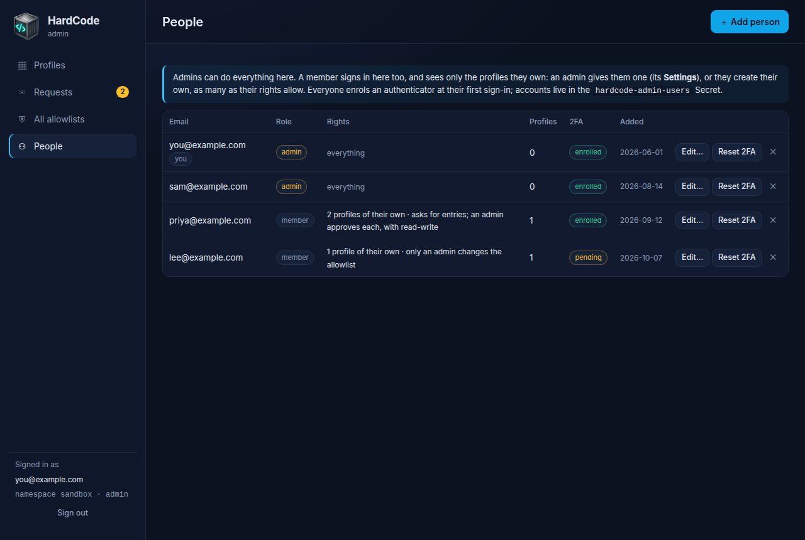
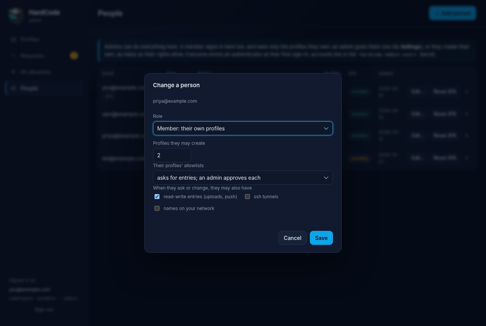
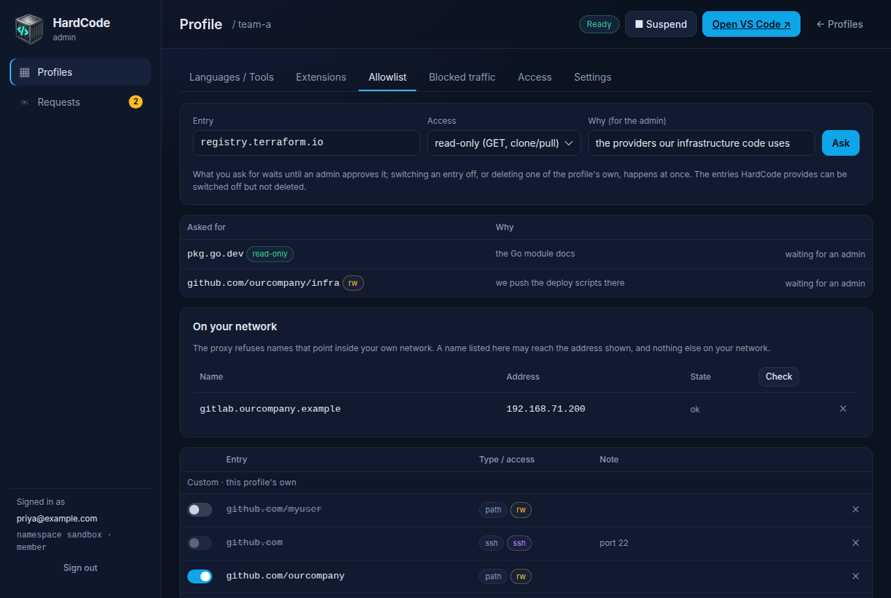

# The admin UI and API

The admin UI is where a team's HardCode on [Kubernetes](kubernetes.md) is
run from: create sandboxes (profiles) for people, choose their languages
and tools, decide what each may reach, see what they were refused, hand
out VS Code's address, suspend, resume and delete them, and manage the
people who sign in. It is served by the same process as the operator, and
speaks a small JSON API that the page, the end-to-end test and your own
scripts use ([the API](#the-api)).

Two kinds of people sign in. **Admins** can do everything. **Members**
see only the profiles they own, and work on them themselves: an admin
gives them a profile, or they create their own, and an admin decides what
they may do with its allowlist ([People](#people),
[What a member sees](#what-a-member-sees)).

## Signing in


Admins and members sign in the same way.

1. Enter your email and password.
2. **The first time**, the page shows a QR code, and the secret written
   out, for an authenticator app (Google Authenticator, 1Password, Authy,
   …). Scan it, and enter the code the app shows to finish.

   

3. **Every time after that**, enter the current code from your
   authenticator app.

   

The code step lasts 5 minutes. After that, or after too many wrong codes,
the page asks for your password again and says why. A session ends after
2 hours without activity, and after 12 hours in any case; a tab left open
doesn't keep it alive.

## Profiles


The list shows every profile with its phase and message from the
operator, who owns it (under its name), its languages (*all* when every
one is on; its tools are on its own page), its image, its allowlist counts
(enabled entries, `rw`, `ssh`) and its age. A profile being deleted shows *Deleting* until Kubernetes has
removed everything it owned; its name is free again after that. Search
filters the list, which refreshes itself every 10 seconds.

### Create a profile


1. Click **＋ New profile**.
2. Give it a **Name**: `a-z`, `0-9` and `-`, up to 32 characters,
   starting with a letter and not ending in `-` (the operator names
   Services after it; capitals are made lowercase).
3. Choose where its **allowlist and settings** come from: the template,
   or a copy of an existing profile (a copy never takes the source's
   Ingress host or fixed token).
4. Tick its **languages and tools**. From the template, the five tools
   are ticked and no language: pick the ones the profile is for, and the
   allowlist entries HardCode provides follow them. A copy starts with its
   source's ticked, and keeps its source's allowlist (its own entries, and
   the provided ones it switches off) whatever languages it ends up with.
5. Optionally, give it an **Owner**: the member it is for, who then sees
   and manages it here. With nobody, only admins see it.
6. Optionally, give it a **VS Code image** and a **VS Code host** for an
   Ingress.
7. Click **Create**. The operator brings the profile up within seconds.

### A profile's page

Open a profile from the list. The header shows its phase,
**■ Suspend** / **▶ Resume** (scales the VS Code container, the proxy and
the DNS server to zero, keeping their volumes) and **Open VS Code ↗** when
the profile has a host name. Six tabs follow; a profile opens on its
languages and tools.

#### Languages / Tools


A card for each language, then each tool, with its switch, the toolchain
it stands for, the allowlist entries it **opens** and the VS Code
extensions it **brings** (one too long for the card is cut short with
"…", and its tooltip has it whole).

Switching one sets `spec.languages`, and the operator gives the proxy the
language's entries, or takes them away, a few seconds after the last
change (`spec.allowlist`
isn't touched, and an entry switched off there stays off). Its extensions
follow without a restart: the operator rewrites the profile's extension
list (the `<profile>-vscode-extensions` ConfigMap), the kubelet brings the
change into the running pod, and the VS Code container installs and
removes extensions to match in the background, starting within about a
minute (the **Extensions** tab shows how far it has got).

On Kubernetes, the image (**Settings**) decides which toolchains a VS Code
container actually has. The default image has them all, so a language
switched off still has its compiler there, just not its registries or its
extensions.

**Ubuntu packages**, below the tools, adds packages of the profile's
own: the VS Code container installs them each time it starts, which
makes starting slower, and a change restarts it. For more than packages,
give the profile an image of its own under **Settings**.

The list sent is made from the profile as it is at the moment of the
switch, so another admin's switch meanwhile isn't undone, and a concurrent
allowlist edit is kept (the write is redone on top of it, as single
allowlist edits are). A switch whose write fails goes back.

#### Extensions


First, how far the running VS Code container has got with its extensions,
read from the end of its log and kept current by the page's ten-second
refresh: *Installing in the background: 9 of 14 in place* while it works,
*All 14 installed* once it is done, with how many were **refused** (a
publisher without a verified domain) and how many are **to try again**
(they couldn't be installed or checked; the container tries again a
minute later), or a note that the VS Code container hasn't reported yet
(suspended, or only just started).

Then what the VS Code container gets, and why: the extensions **every VS
Code container** has, then those of each language and tool that is on; a
line names the ones that are off and would bring some.

Below, **Your extensions**, the profile's own (`spec.extensions`): add one
by its id (`publisher.name`, as the Marketplace shows it), or remove one
with **✕**. Adding one the VS Code container gets anyway changes nothing
and says so (*… already comes with Python*); one of yours that a language
switched on later also brings is marked *already comes with …*; a
language's own extension can't be removed here (*… comes with Python;
switch that off in Languages / Tools to remove it*). Only extensions whose
publisher has a domain the Marketplace has verified are installed: any
other is refused, and the VS Code container's log says so. A change
reaches the running VS Code container within about a minute (the kubelet
updates the ConfigMap in the pod on its own schedule), and it installs or
removes the extension in the background, without a restart.

#### Allowlist


Every entry, as in the desktop app: the profile's own first, then
HardCode's, grouped by where they come from. Each has a switch and, for
your own, a delete button; the form at the top adds one
([entries explained](allowlist.md)).

- A row's switch and delete button act on that row's rule, so an SSH
  entry and the HTTPS entry for the same host are handled apart; a switch
  whose edit fails goes back to where it was.
- A provided entry has a badge (*every profile*, or its language) where
  the delete button would be: it can be switched off, which writes
  `off <entry>` into `spec.allowlist` and lasts through updates and
  language switches, but not deleted.
- Changes go into `spec.allowlist`, and the operator rolls the profile's
  proxy and DNS server five seconds after the last one, so they are live
  within seconds, and several changes in a row are one restart; there is
  no separate *Apply*. The profile is *Pending* until the proxy has them.
- Two admins editing the same profile at once can't lose each other's
  edits: every single-entry write names the version it read, and one that
  lost the race is applied again on top of the newer text.
- Requests from the profile's member that wait for an admin are listed
  above the entries, with **Approve** and **Deny**, as on the
  [Requests](#requests) page.
- **On your network** lists the names that may reach an address on the
  network, with a form for a name and its address. **Check** looks the
  names up (a row says *not checked* until then); one marked *now
  resolves to …* has **Move…**, and **✕** removes one. The chart decides
  whether these are used at all; while it doesn't, the card says so
  ([Kubernetes](kubernetes.md)).

**Edit as text…** opens `spec.allowlist` (the profile's own entries and
its `off` lines; the provided entries aren't in it) for bigger edits. It
is checked before it is saved, and the save carries the version of the
spec the editor was opened at (its `generation`), so if anyone changed the
profile's spec meanwhile it is refused with *changed since you opened it*
rather than overwriting their change (the Settings form does the same);
the operator's status updates don't count as a change. While a form holds
unsaved input, the page's ten-second refresh leaves it alone.


#### Blocked traffic


What this profile's proxy and DNS server refused in the last 10 minutes
to 24 hours, read from their logs and counted by target. **Allow host**
and **Allow URL** fill in the Allowlist tab's form with the name: it came
from the sandbox's own traffic, so it gets a look before it is allowed
([what to ask](staying-safe.md#read-blocked-traffic-before-you-allow-anything)).
A row that says *resolves to an internal address* points inside the
network; **Allow on your network** fills in the On your network form.

#### Access


VS Code's address, with its token hidden (**Show** reveals it; **Copy**
and the links use the whole address), behind the Ingress, or with the
`kubectl port-forward` command to use instead. **New token…** writes a new
token into the profile's token Secret after asking, so that every copy of
the old one stops working: the operator restarts VS Code with it within a
minute (a token the spec fixes, `vscodeToken`, is changed there instead).
Below: the names of the token Secret, the proxy's address and the DNS
ClusterIP.

#### Settings


- **The owner**: the member the profile belongs to, who sees and manages
  it, or nobody (only admins see it).
- **The image**: empty means the operator's default, shown as the
  placeholder; saving the form with it empty keeps inheriting.
- **The VS Code host** for an Ingress: clearing it removes the Ingress.
- **The home volume's size**: a Kubernetes quantity such as `20Gi` or
  `500Mi`. An existing volume is grown where the StorageClass allows; it
  can't shrink.
- **The Docker sidecar**, switchable at any time. The box shows the value
  in effect, and is saved only when changed, so a profile that inherits
  the chart's default keeps inheriting it.
- **Suspended**.

Then the profile's raw status, and **Delete profile**, which asks first:


Deleting removes everything the profile owns, its volumes included.

## All allowlists


Admins only. One entry, applied to **every profile** at once: add, enable, disable or
remove. **Access** is the flag an added entry gets, and also picks the
rule the other three act on: *ssh tunnel* removes, enables or disables the
`ssh` entry, not the HTTPS one for the same host. The result lists, for
each profile, whether it changed; an invalid entry is refused before
anything is touched. A provided entry can be enabled or disabled
everywhere, but not removed (each profile reports the refusal).

## Requests



What members have asked to allow. **Waiting** lists the requests no admin
has decided yet, newest first: the profile, who asked, the entry and its
access (or a name and the address it should reach), and why they said they
need it. **Approve** makes the change, as if you had added it on the
profile's Allowlist tab, and the proxy has it a few seconds later; **Deny**
changes nothing. Either way the member sees what became of it. **Decided**
lists the latest decisions, and who made them.

The count beside **Requests** in the navigation says how many are waiting.

When the chart has an SMTP server (`admin.smtp`), every admin also gets an
email about each new request, with a link to it here. The link opens this
page with the request marked, once you have signed in: approving or denying
always takes a signed-in admin, never the link alone. Without an SMTP
server, requests are only shown here.

A request for a profile someone has since deleted with `kubectl`, or given
to someone else, can only be denied: it says so instead of **Approve**. Deleting a profile here forgets the requests waiting for it.

## People



Everyone who signs in here, with their role, their rights, how many
profiles they own and whether they have enrolled their authenticator.

**＋ Add person** asks for an email, a temporary password (12 characters
or more) and a role: a **member** (their own profiles) or an **admin**
(everything). They enrol their authenticator app when they first sign in.
**Edit…** changes someone's role, or a member's rights:



- **Profiles they may create**: how many of their own, 0 for none (an
  admin can still give them one). Profiles an admin gives them count
  towards it too.
- **Their profiles' allowlists**:
  - *only an admin changes the allowlist*: they see it, and can't change it.
  - *asks for entries; an admin approves each*: what they add waits on the
    [Requests](#requests) page.
  - *changes the allowlist at once*: what they add is added.
- **When they ask or change, they may also have** read-write entries,
  ssh tunnels, and names on your network. Without a tick, they can't add
  that kind of entry at all, not even by asking.

Changes apply at once, and the person's page follows within ten seconds. **Reset 2FA** makes someone
enrol again; **✕** removes a person. Removing a member leaves their
profiles as they are, with their email as the owner, for an admin to give
to someone else or delete. The last admin can't be removed or made a
member.

Removing a person ends their sessions at once, and so do a password
change (except for the session that made it) and a 2FA reset.

## What a member sees



A member's navigation has **Profiles**, and **Requests** when they ask for
entries. Their profile list has only the profiles they own; anyone else's
isn't there for them at all. On their own profiles they can:

- suspend and resume them, and delete them;
- create new ones, as many as their rights allow: from the template, or as
  a copy of one of their own, which takes its allowlist, languages,
  extensions and packages, and the chart's defaults for the rest;
- switch languages and tools on and off, and add extensions and Ubuntu
  packages;
- open VS Code, copy its address and give it a new token;
- see **Blocked traffic**;
- change the allowlist as their rights allow. Switching an entry off, or
  deleting one of the profile's own, is always at once for a member who
  asks or changes; what they add waits for an admin when they ask. A
  member who asks can say why, which the admins see.

The image, the VS Code host, the volumes, the Docker sidecar and the
owner are an admin's: a member's Settings tab shows them, and has only
**Suspended** to change. **All allowlists** and **People** aren't there
for them.

Switching a language or tool on opens the entries HardCode provides for
it, whatever the member's allowlist rights: those are HardCode's own
list. Claude Code's and Codex's include read-write entries for their own
services ([security](security.md#the-admin-ui)).

## Reference

### How sign-in is protected

- **Passwords** are stored as scrypt hashes (N=2¹⁵, r=8, p=1, 16-byte
  salt). A password is hashed at most twice at a time, the other sign-ins
  waiting their turn: each hash takes 32 MB, and eight at once (the
  server's threads) were the container's whole 256 MiB. An unknown email
  costs the same password check as a wrong password, so response times
  don't reveal which accounts exist.
- **Codes** are TOTP, RFC 6238 (SHA-1, 6 digits, 30 s, one step of drift
  accepted), and **a code is accepted once**: the step it was used for is
  remembered. A code is used up in the same write that checks it, so two
  requests carrying the same code can't both get in.
- **The session cookie** (`hc_session`) is `HttpOnly`, `SameSite=Strict`
  and `Secure` according to `COOKIE_SECURE`; it lives 12 hours and
  expires after 2 hours idle. The page's own ten-second refresh isn't
  activity: it sends `X-HardCode-Poll: 1`, so a tab left open times out
  too.
- **The code step** (the password-only stage) lives 5 minutes and is
  thrown away after **5 wrong codes**, and the account itself allows **15
  wrong codes per 15 minutes across challenges**: signing in with the
  password again doesn't buy more guesses.
- **Failed passwords**: eight from one address for one account within 15
  minutes block that pair, and 40 from anywhere block the account, for
  the rest of the window. The address is the connection's, unless it came
  from a proxy listed in `admin.trustedProxies` (`TRUSTED_PROXIES`); then
  it is taken from `X-Forwarded-For`, read from the right: past the
  proxies listed, the next address is the client's, as the first of them
  saw it (anything to its left is whatever the client sent, so it never
  counts).
- **Writing requests** must carry a JSON content type and come from the
  page's own origin (`Origin` / `Sec-Fetch-Site` are checked), which keeps
  cross-site and sibling-subdomain requests out; the page refuses to be
  framed.
- **Revocation is immediate**: removing an admin ends their sessions, and
  so do a password change (except the session that made it) and a 2FA
  reset; every request checks again that the account still exists with
  the credentials the session was created under. Sessions are kept in
  memory (the admin runs as one gunicorn worker), so a restart signs
  everyone out.

Accounts, admins' and members', live in the `hardcode-admin-users` Secret
(`users.json`) in the release's namespace, each with its `role` and a
member's `rights`. Every change to it is written with the version it was
read at (and refused and redone if the Secret moved meanwhile), and the
admin's own writes are serialised, so concurrent account changes can't
undo each other. The bootstrap admin from the chart's values is created
only while that list is empty.

### Members and requests

- **A profile is a member's** when its `spec.owner` is their email. Every
  request about a profile checks it: another's profile is `404` to a
  member, as if it weren't there, and an admin's route (the bulk
  allowlist, the accounts, approving and denying) is `403`. The account
  is read on every request, so a change of role or rights applies at
  once.
- **What a member may change**: `PATCH /api/profiles/{name}` with
  `suspended` or `languages`; anything else (`image`, `vscodeHost`, the
  volumes, `docker`, `resources`, `env`, the allowlist as text, `owner`,
  …) is `403`. A new profile of theirs is theirs, can't be given an image,
  a host or an owner, and is counted and created under one lock, so two at
  once can't both take the last one their limit allows. A copy of one of
  theirs takes only what they may set themselves (`allowlist`,
  `languages`, `extensions`, `packages`), so an admin's settings for one
  profile (the Docker sidecar, a mount, the environment) stay that
  profile's.
- **What an allowlist edit opens** is judged by what the proxy would be
  given, not by what the request says: the profile's own allowlist before
  and after the edit, with its languages' entries. Each entry the edit
  would allow that wasn't allowed (read-only where the same entry was
  read-write doesn't count) needs the member's allowlist right, and a
  read-write, ssh or network one its tick. So switching on
  `github:OWNER/REPO`, or one entry switched off by an admin, needs the
  `rw` tick when those entries are read-write. The comparison is made
  under the profile's languages and under every language, since a member
  may switch languages: taking away an admin's `off` line counts while
  its language is off too. The flag is `""`, `rw` or `ssh` for every op,
  and a switch's request keeps only whether it is the ssh rule. An edit
  that opens nothing
  (switching off, deleting) is made at once for a member who asks or
  edits; under *ask*, one that opens something becomes a request, and is
  checked again on the text it is finally made on.
- **Requests** are kept in the `hardcode-admin-requests` Secret
  (`requests.json`), versioned as the accounts are. A request records the
  edit to make (`op`, `entry`, `flag`, or a name and `address`) and what
  it would open (`access`), which is what the admins are shown. Asking for
  the same change again is the request already waiting. A member has at
  most 20 waiting and everyone 150; a request is at most 2 KB as stored
  (its reason at most 500 characters), and the latest 100 decided
  requests are kept, so the Secret stays well under the 1 MiB Kubernetes
  allows one. An approval for a profile that has gone, or that no longer
  belongs to the member who asked, is refused before anything is marked.
  Otherwise approving marks the request first, so a second admin can't
  decide it meanwhile; if the edit then can't be made, the request waits
  again.
- **Emails** are sent with Python's `smtplib`, one per admin, in a thread
  of their own, so no request waits for the server; a failure is logged
  (`couldn't email the admins about request …`). TLS is checked against
  the image's certificates. The link is `ADMIN_URL/#request/<id>`: it
  only opens the page, and the page asks for a sign-in first.

### The API

All paths are relative to the admin Service. Request and response bodies
are JSON; every `POST`, `PATCH` and `DELETE` must send `Content-Type:
application/json` (`415` otherwise, even without a body) and, from a
browser, come from the admin's own origin (`403` otherwise). Errors are
`{"error": "…"}` with the status codes below. Everything except
`/healthz`, `/api/login`, `/api/totp` and `/api/me` needs a fully
signed-in session; a session whose account was removed or had its
credentials changed gets `401`. A member gets `403` for a route that is
an admin's alone, and `404` for a profile that isn't theirs
([members and requests](#members-and-requests)). A request carrying
`X-HardCode-Poll: 1` (the page's background refresh sends it) doesn't
count as activity for the idle timeout.

| Method and path | Body | Response |
|---|---|---|
| `POST /api/login` | `{email, password}` | `{"next": "totp"}` or, when not yet enrolled, `{"next": "enrol", "otpauth", "secret", "qr"}` (an SVG data URL); sets the cookie. `401` wrong, `429` throttled |
| `POST /api/totp` | `{code}` | `{"ok": true, "email"}`; `401` `wrong code` for a wrong or already-used code (the fifth wrong one ends the challenge: sign in again), any other `401` (`sign in first` once the 5-minute challenge has expired) means the challenge is over |
| `POST /api/logout` | `{}` | `{"ok": true}` |
| `GET /api/me` | | `{"email", "namespace", "role": "admin"\|"member", "rights", "mail"}` or `null`; `rights` is a member's (`null` for an admin), `mail` whether new requests are emailed to the admins |
| `GET /api/profiles` | | `[summary…]`: `name`, `createdAt`, `image`, `suspended`, `phase` (the operator's, or `Deleting` while Kubernetes removes the profile), `message`, `languages` (the keys of the languages and tools that are on, in catalogue order), `entries`, `rw`, `ssh`, `vscodeHost`, `owner` (an email, or `""`). A member gets only their own |
| `GET /api/languages` | | the catalogue, languages first and then tools: `[{key, name, desc, kind: "language"\|"tool", domains, extensions}…]` (`domains`: the allowlist entries it opens; `extensions`: the VS Code extensions it brings) |
| `POST /api/profiles` | `{name, from?, languages?, image?, vscodeHost?, owner?}` | `201` summary, with the name as stored (lowercased). With `languages` (keys or the CLI's aliases, such as `js`), the profile gets them as `spec.languages`; without, a copy keeps its source's languages, and a profile from the template has none of its own (`profileDefaults.languages`, or all of them). Its `spec.allowlist` is the template's, or the copy's source's, either way; a copy never takes its source's `vscodeHost`, `vscodeToken` or `owner`. `owner` is an account's email. A member's profile is their own; `403` when they give `image`, `vscodeHost` or `owner`, or have as many profiles as their rights allow. `400` bad name (`a-z`, `0-9`, `-`, up to 32 characters, a letter first, not ending in `-`), host name, language or owner, `404` unknown `from` (or a member's copy of another's), `409` exists or is still being deleted |
| `GET /api/template` | | `{"allowlist"}`: what new profiles start from |
| `GET /api/profiles/{name}` | | summary + `languages` (here the whole catalogue, each entry with `enabled`) + `extensions` (every extension the VS Code container gets and why: `[{id, source: "core"\|<language key>\|"custom", enabled, duplicate?}…]`, those of languages that are off with `enabled: false`; `duplicate` marks one of the profile's own that the catalogue lists too) + `extensionStatus` (how far the running VS Code container has got with them, from the latest progress line in the last 1000 lines of its log: `{state: "installing"\|"done", installed, total, refused, failed}`, `installed` of the `total` wanted extensions in place, `refused` turned away for an unverified publisher, `failed` to be tried again; while installing, `refused` and `failed` count this pass so far; `null` when there is no pod or no such line yet) + `spec` (with `effective`, the defaults filled in) + `status` + `allowlist` (every entry, provided and the profile's own, as in the CLI's `hardcode --json allowlist`) + `access` (`token`, `url`, `portForward`, `host`) + `requests` (those waiting for this profile: every one to an admin, a member's own to them) + `version` (the spec's `generation`, for an editing precondition) |
| `PATCH /api/profiles/{name}` | any of `image`, `suspended`, `home`, `shared`, `docker`, `resources`, `env`, `vscodeHost`, `networkPolicy`, `upstreamDNS`, `extraVolumes`, `extraVolumeMounts`, `allowlist` (an empty `image`/`vscodeHost` removes the field; a text `allowlist` gets its final newline), `owner` (an account's email; empty: nobody's), `languages` (the whole list of languages and tools to have on; the provided allowlist entries follow it), plus an optional `version` (the `version` a `GET` returned: the edit is refused if the spec changed since; status updates don't count) | summary; `400` for an allowlist with an invalid entry, a `vscodeHost` that isn't a host name, a `home`/`shared`/`docker` `size` that isn't a Kubernetes quantity (`20Gi`, `500Mi`), or `languages` that aren't a list of known languages, or an `owner` with no account; `403` for a member changing anything but `suspended` and `languages`; `409` if the spec changed since the `version` given, or the profile since it was read (a `languages` change is first redone on top of a concurrent edit, a few times) |
| `DELETE /api/profiles/{name}` | | `{"ok": true}`; the requests waiting for it are forgotten |
| `POST /api/profiles/{name}/token` | | `{"message"}`: a new VS Code token in the profile's token Secret; the operator restarts VS Code with it within a minute. `400` when the spec fixes the token (`vscodeToken`), `409` before the operator has made one |
| `POST /api/profiles/{name}/extensions` | `{op: "add"\|"remove", id}` | `{"changed": bool, "message"}`: an extension of the profile's own added to or removed from `spec.extensions` (the running VS Code container installs or removes it in the background within about a minute, without a restart); adding one the VS Code container already gets is `changed: false` (`… already comes with Python`, `… is already added`). `400` for an id that isn't `publisher.name`, removing a language's (`… comes with Python; switch that off in Languages / Tools to remove it`; one every VS Code container has can't be removed) or one the profile doesn't have, and for adding one to a profile that has 100 of its own already |
| `POST /api/profiles/{name}/allowlist` | `{op: "add"\|"remove"\|"enable"\|"disable", entry, flag?, reason?}` | `{"changed": bool}`, with the CLI's rules: a provided entry is switched off and on with an `off` line, and `add` of one switches it back on. A member's edit goes by their rights: `403` without them (or without the tick for a read-write or ssh entry it would open); one that would open something, under *ask*, is `202` `{"changed": false, "requested": true, "request"}`, with `reason` for the admins (`400` when the request would be too long, or too many are waiting). `400` invalid op, entry or flag, or `remove` of a provided entry |
| `POST /api/profiles/{name}/lan` | `{op: "add"\|"remove", name, address?, reason?}` | `{"changed": bool, "message"}`; a member's goes as an allowlist edit does, a new name or address needing the network tick |
| `POST /api/profiles/{name}/lan/check` | `{}` | the On your network card, every name looked up from the admin |
| `POST /api/allowlist/bulk` | the same as `…/allowlist` | `{"<profile>": "changed"\|"unchanged"\|"error: …"}`; `400` invalid op or entry. Admins only |
| `GET /api/requests` | | `[request…]`: waiting first (newest first), then decided (the latest decision first). Each has `id`, `profile`, `by`, `kind` (`entry` or `lan`), `op`, `entry`, `flag`, `access` (what it would open: `""`, `rw` or `ssh`), `address`, `reason`, `createdAt`, `state` (`pending`, `approved`, `denied`), `decidedBy`, `decidedAt`, `profileGone` and `notTheirs` (its profile now belongs to someone else). A member gets their own |
| `POST /api/requests/{id}/approve` | `{}` | `{"request", "changed"}`: the change is made; `404` no such request or its profile has gone, `409` decided already or the profile no longer the asker's. Admins only |
| `POST /api/requests/{id}/deny` | `{}` | `{"request"}`; `404`, `409` as above. Admins only |
| `GET /api/profiles/{name}/blocked?since=10m\|30m\|2h\|24h` | | `[{kind, method, host, url, target, client, count}…]` |
| `GET /api/users` | | `[{email, role, rights, profiles, totpEnrolled, createdAt}…]`; `profiles` is how many they own. Admins only |
| `POST /api/users` | `{email, password, role?, rights?}` | `201`: a member unless `role` is `admin`. `rights` is `{profiles, allowlist: "none"\|"ask"\|"edit", rw, ssh, lan}`; what it leaves out is `{profiles: 1, allowlist: "none", rw: false, ssh: false, lan: false}`. `400` invalid. Admins only |
| `PATCH /api/users/{email}` | `{role?, rights?}` | the account as `GET /api/users` lists it; `rights` replaces them whole. `400` for making the last admin a member. Admins only |
| `DELETE /api/users/{email}` | | `400` for the last admin. Admins only |
| `POST /api/users/{email}/reset-totp` | `{}` | Admins only |
| `POST /api/users/{email}/password` | `{password}` | an admin's for anyone, a member's for themselves |
| `GET /healthz` | | `{"ok": true}` (no session needed; the probes use it) |

A session from a script, with the TOTP secret read from the Secret:

```sh
api() { curl -sS -b cj -c cj -H 'Content-Type: application/json' "$@"; }
api -X POST http://localhost:8080/api/login -d '{"email":"you@example.com","password":"…"}'
code=$(cd admin && python3 -c "from hardcode_admin.totp import totp; print(totp('$SECRET'))")
api -X POST http://localhost:8080/api/totp -d "{\"code\":\"$code\"}"
api -X POST http://localhost:8080/api/allowlist/bulk -d '{"op":"add","entry":"github.com/ourcompany","flag":"rw"}'
```

### Configuration

The chart sets these from its values; they matter when you run the admin
yourself.

| Variable | Default | Meaning |
|---|---|---|
| `K8S_NAMESPACE` | the service account's | the namespace to manage |
| `ADMIN_EMAIL`, `ADMIN_PASSWORD` | | the bootstrap admin, used only while no accounts exist |
| `USERS_SECRET` | `hardcode-admin-users` | where accounts are kept |
| `PROFILE_DEFAULTS_JSON` | `{}` | the chart's `profileDefaults` |
| `COOKIE_SECURE` | `auto` | `auto` / `always` / `never` |
| `TRUSTED_PROXIES` | empty | comma-separated addresses or CIDRs whose `X-Forwarded-For` is believed |
| `ADMIN_URL` | the chart's `admin.url`, or its Ingress's host | the portal's address, for the links in the admins' emails |
| `SMTP_HOST` | empty: no emails | the SMTP server members' requests are emailed through |
| `SMTP_PORT` | `587`, or `465` with `SMTP_TLS=tls` | |
| `SMTP_TLS` | `starttls` | `starttls`, `tls` (from the start) or `none` |
| `SMTP_FROM` | | the sender's address; needed with `SMTP_HOST` |
| `SMTP_USERNAME`, `SMTP_PASSWORD` | empty: no login | the server's login, from a Secret |
| `OPERATOR`, `ADMIN` | `1` | set either to `0` to run only the other half |
| `TEMPLATE_ALLOWLIST` | `/app/template-allowlist.txt`, else the checkout's `template/allowlist.txt` | what new profiles start from |
| `K8S_API`, `K8S_TOKEN`, `K8S_CA_FILE` | in-cluster | for development: `kubectl proxy`, then `K8S_API=http://127.0.0.1:8001` |
| `PORT` | `8080` | |

### For contributors

From a checkout, against any cluster you have access to:

```sh
kubectl apply -f helm/hardcode/crds/
kubectl proxy &
cd admin && K8S_API=http://127.0.0.1:8001 K8S_NAMESPACE=sandbox ADMIN_EMAIL=you@example.com ADMIN_PASSWORD='a long password' python3 -m hardcode_admin
```

```
admin/hardcode_admin/web.py        the API and the page's routes (Flask)
admin/hardcode_admin/operator.py   watch, reconcile, status
admin/hardcode_admin/manifests.py  the objects one Profile turns into
admin/hardcode_admin/k8s.py        a urllib client for the Kubernetes API: get, list, server-side apply, merge patch, create, delete, logs, watch
admin/hardcode_admin/auth.py       scrypt passwords, the accounts (roles and rights), sessions, the login throttle
admin/hardcode_admin/approvals.py  members' requests: asked for, approved, denied
admin/hardcode_admin/mail.py       the admins' emails about requests (smtplib)
admin/hardcode_admin/totp.py       TOTP and otpauth URLs
admin/hardcode_admin/wsgi.py       builds everything from the environment; `app` for gunicorn
admin/hardcode_admin/web/          index.html, app.js, admin.css (base.css and the icon are copied from app/ into the image)
admin/tests/                       unit and API tests against an in-memory Kubernetes API
images/admin/Dockerfile            the image: Python and openssl from the Ubuntu archive; Flask, gunicorn and qrcode as uv.lock locks them
images/admin/pyproject.toml        the image's Python packages, and uv.lock, which locks them by hash
```
