# Admin UI and API

The admin UI manages a namespace's `Profile` objects: create profiles (from
the template or as a copy) around the languages and tools they are for,
switch those on and off (each opens its block of the allowlist and brings
its VS Code extensions), add extensions of a profile's own and follow their
installing, edit allowlists one by one or all at once, see what each proxy refused, suspend, resume and
delete profiles, read the VS Code access details, and manage the admins
themselves. It is served by the same process as the operator
([Kubernetes](kubernetes.md)) and speaks a small JSON API that the page, the
end-to-end test and your own scripts use.

## Signing in

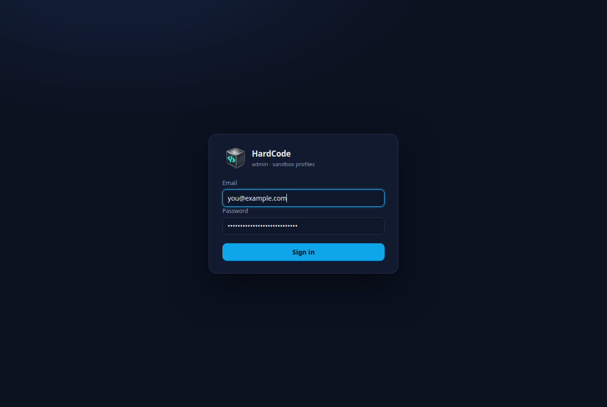

Email and password first. On a **first sign-in** the page shows a QR code
and the manual secret for an authenticator app (Google Authenticator,
1Password, Authy, …); the code it generates completes the enrolment.

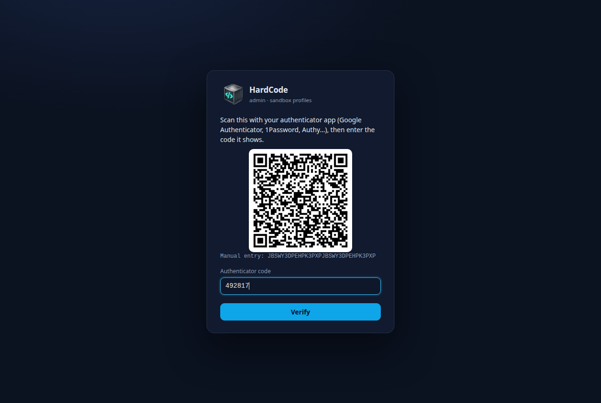

Afterwards every sign-in asks for the current code.

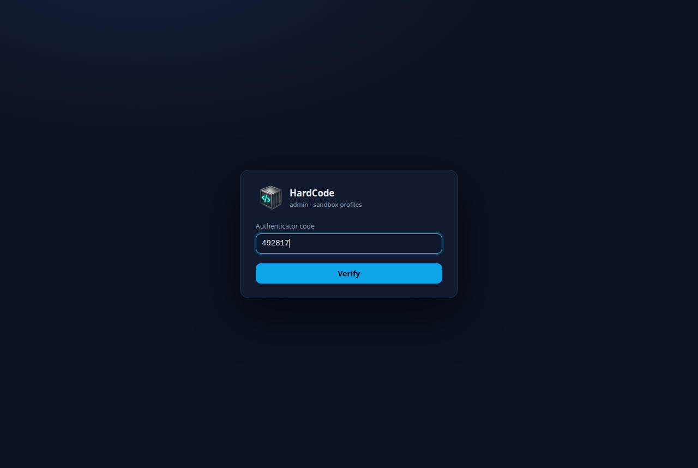

The code step lasts 5 minutes. Verifying after that brings the password
step back (*the sign-in timed out; enter your password again*), as does a
challenge that ended otherwise (too many wrong codes, a revocation), with
its reason.

How it works: passwords are stored as scrypt hashes (N=2¹⁵, r=8, p=1, 16-byte
salt); TOTP is RFC 6238 (SHA-1, 6 digits, 30 s, one step of drift accepted),
and **a code is accepted once**: the step it was used for is remembered.
A code is consumed in the same write that checks it, so two requests
carrying the same code can't both get in. The session cookie (`hc_session`)
is `HttpOnly`, `SameSite=Strict` and `Secure` according to `COOKIE_SECURE`,
lives 12 hours and expires after 2 hours idle (the page's own ten-second
refresh isn't activity: it sends `X-HardCode-Poll: 1`, so a tab left open
times out too); the password-only stage (the
second-factor challenge) lives 5 minutes and is thrown away after **5 wrong
codes**, and the account itself allows **15 wrong codes per 15 minutes
across challenges**: signing in with the password again doesn't buy more
guesses. Eight failed passwords from one address for one account within 15
minutes block that pair, and 40 from anywhere block the account, for the
rest of the window;
the address is the connection's unless it came from a proxy listed in
`admin.trustedProxies` (`TRUSTED_PROXIES`). Then it is taken from
`X-Forwarded-For`, read from the right: past the proxies listed, the next
address is the client's, as the first of them saw it (anything to its left
is whatever the client sent, so it never counts). A password is hashed at
most twice at a time, the other sign-ins waiting their turn: each hash
takes 32 MB, and eight at once (the server's threads) were the container's
whole 256 MiB. Every writing request must carry a JSON content type and come
from the page's own origin (`Origin` / `Sec-Fetch-Site` are checked), which
keeps cross-site and sibling-subdomain requests out; the page refuses to be
framed. An unknown address costs the same password check as a wrong
password, so response times don't reveal which admins exist. **Revocation is
immediate**: removing an admin ends their sessions, and so do a password
change (except the session that made it) and a 2FA reset; every request
re-checks that the account still exists with the credentials the session
was created under. Sessions are in memory (the admin runs as one gunicorn
worker), so a restart signs everyone out.

Admin accounts live in the `hardcode-admin-users` Secret (`users.json`) in
the release's namespace. Every change to it is written with the version it
was read at (and refused and redone if the Secret moved meanwhile), and the
admin's own writes are serialised, so concurrent account operations can't
undo each other. The bootstrap admin from the chart's values is created
only while that list is empty.

## Profiles

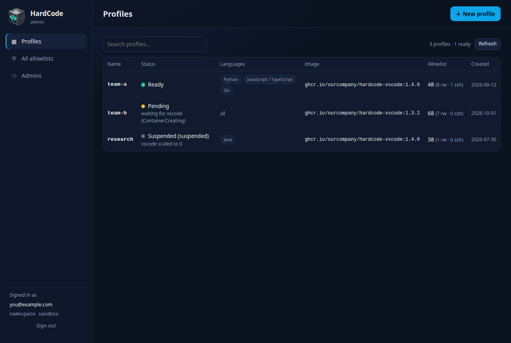

Every profile with its phase and message from the operator, its languages
(*all* when every one is on; its tools are on its own page), image,
allowlist counts (enabled entries, `rw`, `ssh`) and age. A profile being
deleted shows *Deleting* until Kubernetes has removed everything it owned;
its name is free again after that. Search filters the table; the list
refreshes every 10 s. **＋ New profile** opens:

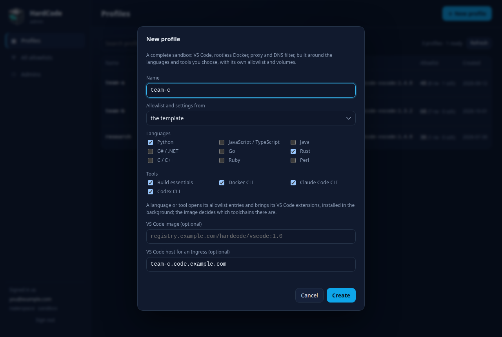

A name (`a-z`, `0-9` and `-`, up to 32 characters, starting with a letter
and not ending in `-`, since the operator names Services after it; capitals
are lowercased), the template or a copy of an existing profile
(its allowlist and settings; a copy never takes the source's Ingress host or
fixed token), the **languages and tools** it is built around, an optional
image and an optional VS Code host name for an Ingress. From the template
the four tools are ticked and no language: pick the ones the profile is
for, and the allowlist entries HardCode provides follow them. A copy
starts with its source's languages ticked, and keeps its source's
allowlist (its own entries, and the provided ones it switches off)
whatever languages it ends up with. The operator brings the new profile up within seconds.

### A profile

The header shows the phase, **Suspend / Resume** (scales the VS Code container, squid and
CoreDNS to zero, keeping volumes) and **Open VS Code** when the profile has a
host name. Six tabs; a profile opened from the list starts at its
languages and tools:

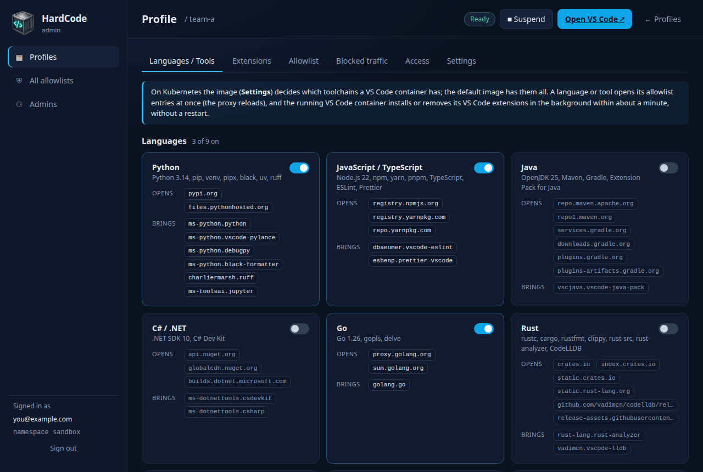

**Languages / Tools**: a card for each language, then each tool, with its
switch, the toolchain it stands for, the allowlist entries it **opens** and
the VS Code extensions it **brings** (one too long for the card is cut
short with "…", and its tooltip has it whole). Switching one sets
`spec.languages`, and the operator gives the proxy the language's entries
or takes them away within seconds (`spec.allowlist` isn't touched, and an
entry switched off there stays off). Its extensions follow without a
restart: the operator rewrites the profile's extension list (the
`<profile>-vscode-extensions` ConfigMap), the kubelet brings the change
into the running pod, and the VS Code container installs and removes
extensions to match in the background, starting within about a minute (the
*Extensions* tab shows how far it has got). On Kubernetes the image
(*Settings*) decides which toolchains a VS Code container actually has; the default image has them all, so a
language switched off still has its compiler there, just not its registries
or its extensions. The list sent is made from the profile as it is at the
moment of the switch, so another admin's switch meanwhile isn't undone, and
a concurrent allowlist edit is kept (the write is redone on top of it, as
single allowlist edits are). A switch whose write fails goes back.

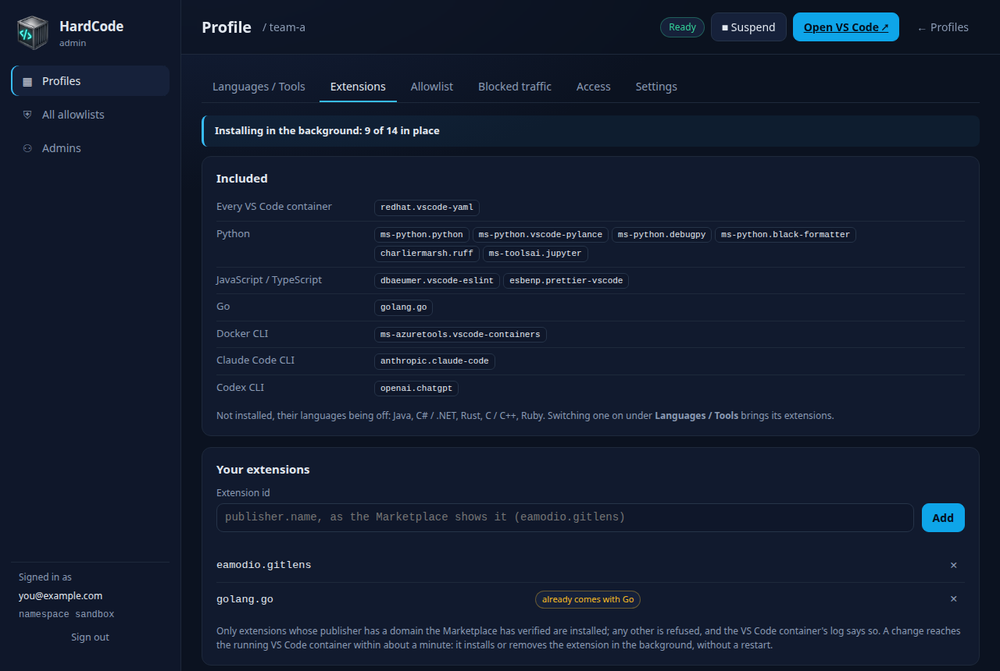

**Extensions**: first, how far the running VS Code container has got with
them, read from the end of its log and kept current by the page's
ten-second refresh: *Installing in the background: 9 of 14 in place*
while it works, *All 14 installed* once it is done, with how many were
**refused** (a publisher without a verified domain) and how many are **to
try again** (they couldn't be installed or checked; the container tries
again a minute later), or a note that the VS Code container hasn't
reported yet (suspended, or only just started). Then what the VS Code
container gets and why: those **every VS Code container** has, then those
of each language and tool that is on; a line names the ones that are off
and would bring some. Below, **your extensions**, the
profile's own (`spec.extensions`): add one by its id (`publisher.name`, as
the Marketplace shows it) or remove it with ✕. Adding one the VS Code container gets
anyway changes nothing and says so (*… already comes with Python*); one of
yours that a language switched on later also brings is marked *already
comes with …*; a language's own extension can't be removed here (*… comes
with Python; switch that off in Languages / Tools to remove it*). Only extensions whose
publisher has a domain the Marketplace has verified are installed: any
other is refused, and the VS Code container's log says so. A change
reaches the running VS Code container within about a minute (the kubelet
updates the ConfigMap in the pod on its own sync period), and it installs
or removes the extension in the background, without a restart.

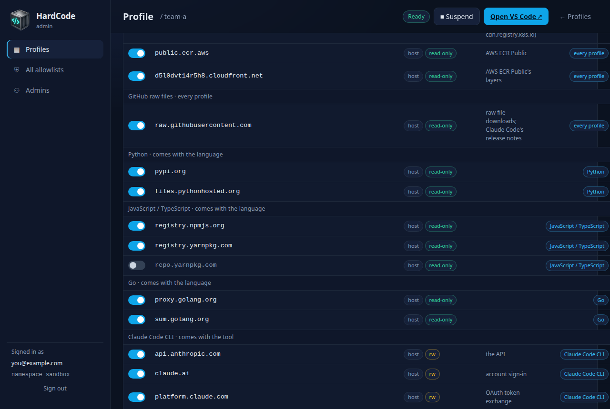

**Allowlist**: every entry, as in the desktop app: those HardCode provides,
block by block (*VS Code · every profile*, …, *Python · comes with the
language*, scrolled to in the picture), then the profile's own, with
toggles, delete buttons and an add form. A row's toggle and delete act on
that row's rule, so an SSH entry and the HTTPS entry for the same host are
handled apart; a toggle whose edit fails goes back to where it was. A
provided entry has a badge (*every profile*, or its language) where the
delete button would be: it can be switched off, which writes `off <entry>`
into `spec.allowlist` and lasts through updates and language switches, but
not deleted. Changes go into `spec.allowlist` and the operator rolls squid
and CoreDNS, so they are live within seconds; there is no
separate *Apply*. Two admins editing the same profile at once can't lose
each other's edits: every single-entry write names the version it read,
and one that lost the race is re-applied on top of the newer text.
**Edit as text…** opens `spec.allowlist` (the profile's own entries and its
`off` lines; the provided entries aren't in it) for bulk edits; it is validated
before it is saved, and the save carries the version of the spec the editor
was opened at (its `generation`), so if anyone changed the profile's spec
meanwhile it is refused with *changed since you opened it* rather than
overwriting their change (the settings form does the same); the operator's
status updates don't count as a change. While a form holds unsaved input the page's ten-second
refresh leaves it alone.

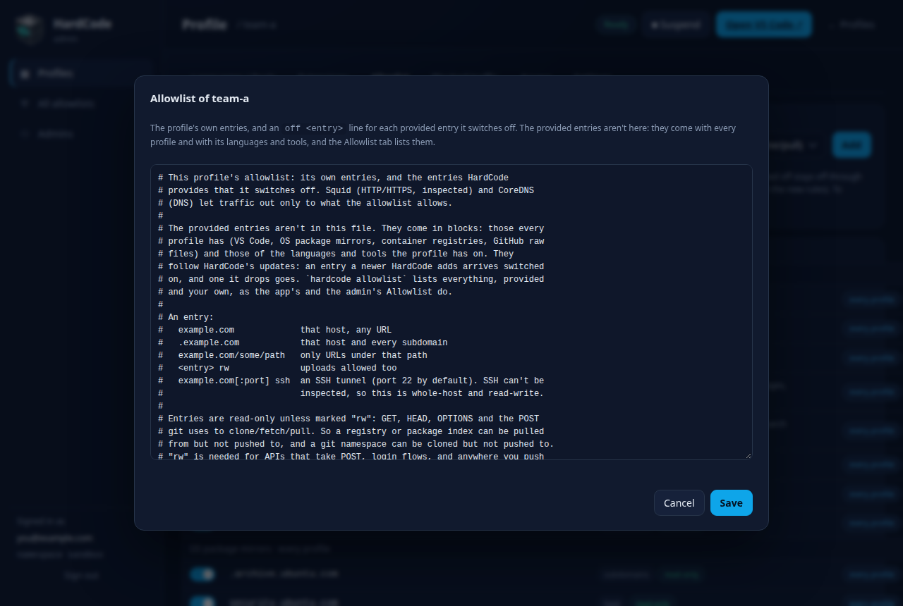

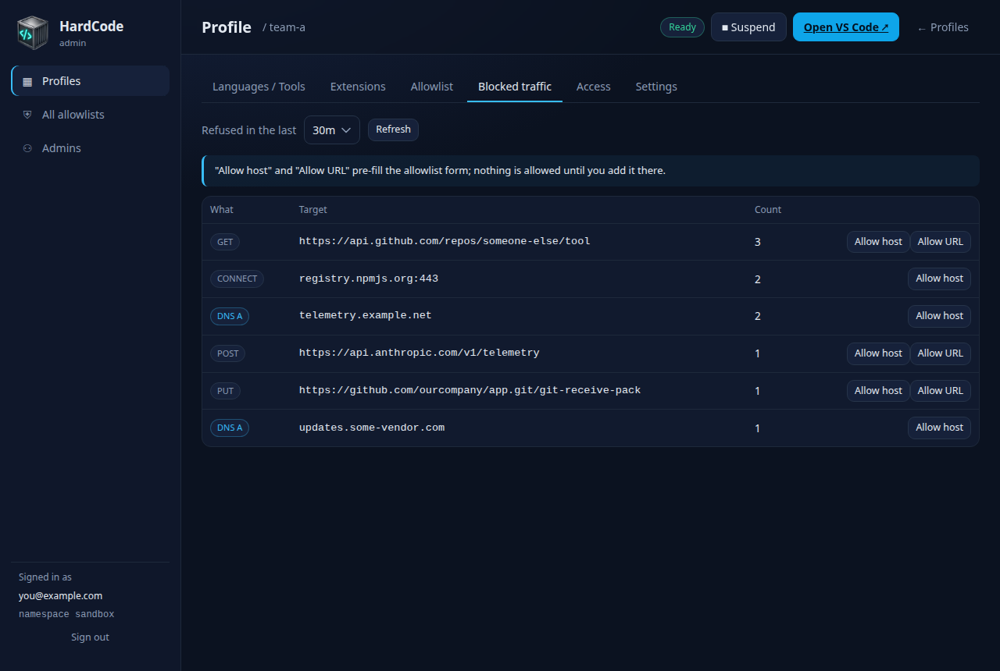

**Blocked traffic**: what this profile's squid and CoreDNS pods refused in
the last 10 minutes to 24 hours, read from their logs and aggregated by
target. *Allow host* / *Allow URL* pre-fill the allowlist form with the name
(it came from the sandbox's own traffic, so it gets a look before it is
allowed), as in the desktop app.

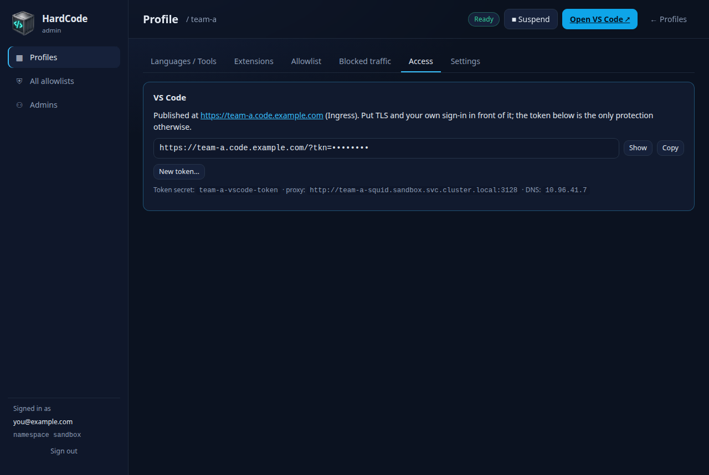

**Access**: the VS Code URL, its token hidden (*Show* reveals it; *Copy* and
the links use the whole URL), behind the Ingress or with the `kubectl
port-forward` command to use instead; *New token…*, which writes a new token
into the profile's token Secret after asking, so that every copy of the old
one stops working (the operator restarts VS Code with it within a minute;
a token the spec fixes, `vscodeToken`, is changed there instead); the names
of the token Secret, the proxy URL and the DNS ClusterIP.

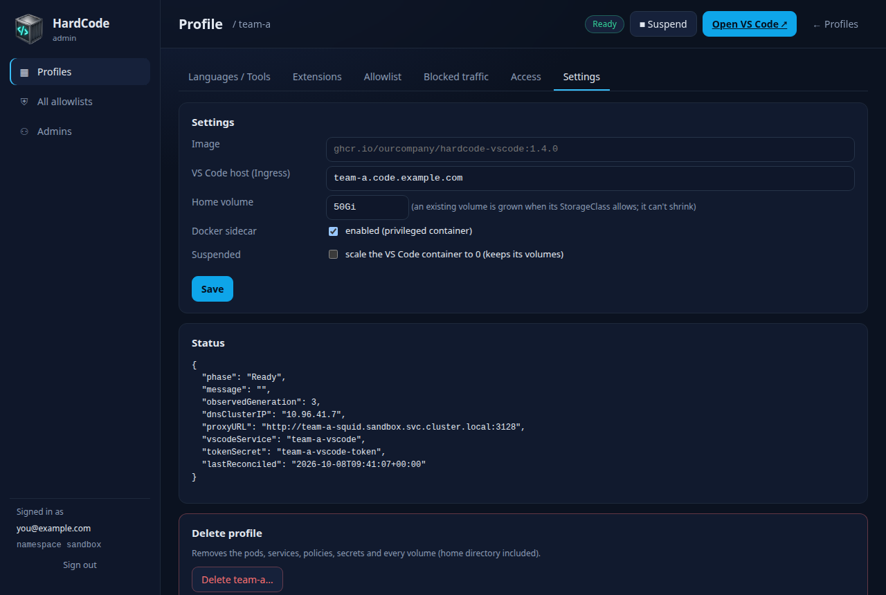

**Settings**: the image (empty means the operator's default, shown as the
placeholder; saving the form with it empty keeps inheriting), the Ingress
host (clearing it removes the Ingress), the home volume size (a Kubernetes
quantity such as `20Gi` or `500Mi`; an existing volume is grown where the
StorageClass allows; it can't shrink), the Docker sidecar (switchable at any
time; the box shows the effective value, and is saved only when changed, so
a profile that inherits the chart's default keeps inheriting it),
suspension; the raw status; and the delete button, which asks first:

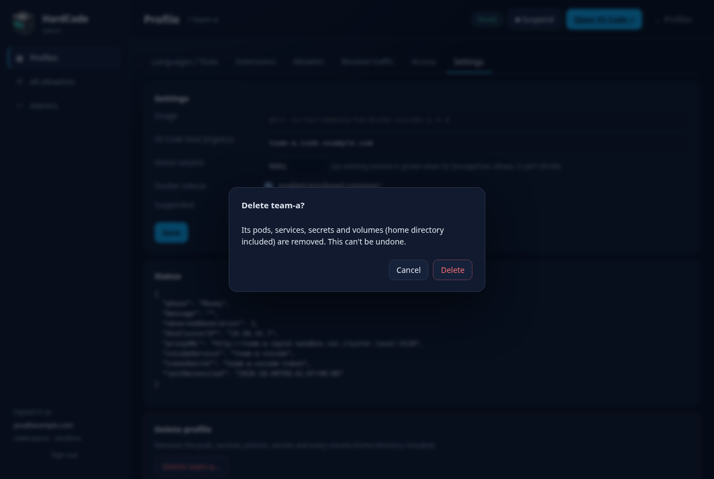

Deleting removes everything the profile owns, volumes included.

## All allowlists

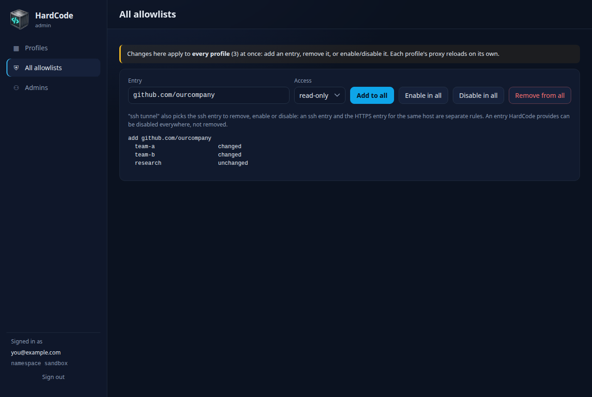

One entry, applied to **every profile** at once: add, enable, disable or
remove. **Access** is the flag an added entry gets, and also picks the rule
the other three act on: *ssh tunnel* removes, enables or disables the `ssh`
entry, not the HTTPS one for the same host. The result lists, per profile,
whether it changed; an invalid entry is refused before anything is touched.
A provided entry can be enabled or disabled everywhere, not removed (each
profile reports the refusal).

## Admins

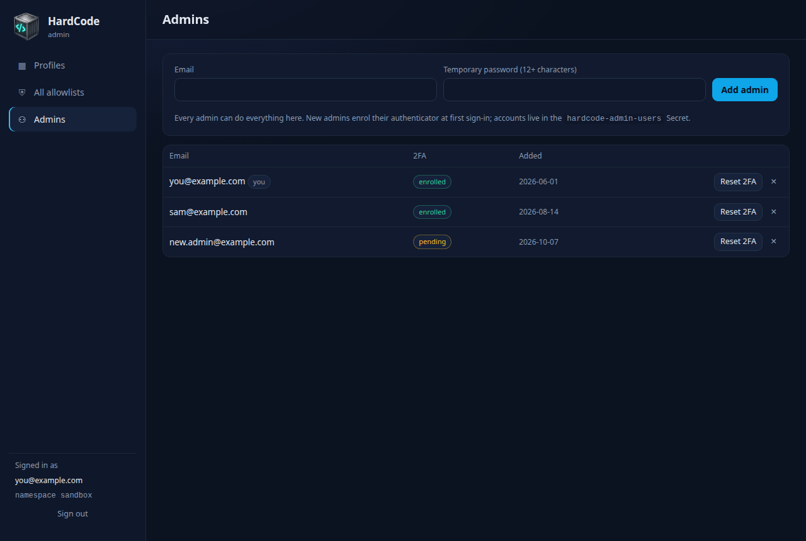

Every admin can do everything. Add one with an email and a temporary
password (12+ characters; they enrol their authenticator at first sign-in),
reset someone's 2FA (they enrol again), or remove them; the last admin can't
be removed.

## The API

All paths are relative to the admin Service. Request and response bodies are
JSON; every `POST`/`PATCH`/`DELETE` must send `Content-Type: application/json`
(`415` otherwise, even without a body) and, from a browser, come from the
admin's own origin (`403` otherwise). Errors are `{"error": "…"}` with the
status codes below. Everything except `/healthz`, `/api/login`, `/api/totp`
and `/api/me` needs a fully signed-in session; a session whose account was
removed or had its credentials changed gets `401`. A request carrying
`X-HardCode-Poll: 1` (the page's background refresh sends it) doesn't count
as activity for the idle timeout.

| Method and path | Body | Response |
|---|---|---|
| `POST /api/login` | `{email, password}` | `{"next": "totp"}` or, when not yet enrolled, `{"next": "enrol", "otpauth", "secret", "qr"}` (an SVG data URL); sets the cookie. `401` wrong, `429` throttled |
| `POST /api/totp` | `{code}` | `{"ok": true, "email"}`; `401` `wrong code` for a wrong or already-used code (the fifth wrong one ends the challenge: sign in again), any other `401` (`sign in first` once the 5-minute challenge has expired) means the challenge is over |
| `POST /api/logout` | `{}` | `{"ok": true}` |
| `GET /api/me` | | `{"email", "namespace"}` or `null` |
| `GET /api/profiles` | | `[summary…]`: `name`, `createdAt`, `image`, `suspended`, `phase` (the operator's, or `Deleting` while Kubernetes removes the profile), `message`, `languages` (the keys of the languages and tools that are on, in catalogue order), `entries`, `rw`, `ssh`, `vscodeHost` |
| `GET /api/languages` | | the catalogue, languages first and then tools: `[{key, name, desc, kind: "language"\|"tool", domains, extensions}…]` (`domains`: the allowlist entries it opens; `extensions`: the VS Code extensions it brings) |
| `POST /api/profiles` | `{name, from?, languages?, image?, vscodeHost?}` | `201` summary, with the name as stored (lowercased). With `languages` (keys or the CLI's aliases, such as `js`), the profile gets them as `spec.languages`; without, a copy keeps its source's languages, and a profile from the template has none of its own (`profileDefaults.languages`, or all of them). Its `spec.allowlist` is the template's, or the copy's source's, either way. `400` bad name (`a-z`, `0-9`, `-`, up to 32 characters, a letter first, not ending in `-`), host name or language, `404` unknown `from`, `409` exists or is still being deleted |
| `GET /api/template` | | `{"allowlist"}`: what new profiles start from |
| `GET /api/profiles/{name}` | | summary + `languages` (here the whole catalogue, each entry with `enabled`) + `extensions` (every extension the VS Code container gets and why: `[{id, source: "core"\|<language key>\|"custom", enabled, duplicate?}…]`, those of languages that are off with `enabled: false`; `duplicate` marks one of the profile's own that the catalogue lists too) + `extensionStatus` (how far the running VS Code container has got with them, from the latest progress line in the last 1000 lines of its log: `{state: "installing"\|"done", installed, total, refused, failed}`, `installed` of the `total` wanted extensions in place, `refused` turned away for an unverified publisher, `failed` to be tried again; while installing, `refused` and `failed` count this pass so far; `null` when there is no pod or no such line yet) + `spec` (with `effective`, the defaults filled in) + `status` + `allowlist` (every entry, provided and the profile's own, as in the CLI's `hardcode --json allowlist`) + `access` (`token`, `url`, `portForward`, `host`) + `version` (the spec's `generation`, for an editing precondition) |
| `PATCH /api/profiles/{name}` | any of `image`, `suspended`, `home`, `shared`, `docker`, `resources`, `env`, `vscodeHost`, `networkPolicy`, `upstreamDNS`, `extraVolumes`, `extraVolumeMounts`, `allowlist` (an empty `image`/`vscodeHost` removes the field; a text `allowlist` gets its final newline), `languages` (the whole list of languages and tools to have on; the provided allowlist entries follow it), plus an optional `version` (the `version` a `GET` returned: the edit is refused if the spec changed since; status updates don't count) | summary; `400` for an allowlist with an invalid entry, a `vscodeHost` that isn't a host name, a `home`/`shared`/`docker` `size` that isn't a Kubernetes quantity (`20Gi`, `500Mi`), or `languages` that aren't a list of known languages; `409` if the spec changed since the `version` given, or the profile since it was read (a `languages` change is first redone on top of a concurrent edit, a few times) |
| `DELETE /api/profiles/{name}` | | `{"ok": true}` |
| `POST /api/profiles/{name}/token` | | `{"message"}`: a new VS Code token in the profile's token Secret; the operator restarts VS Code with it within a minute. `400` when the spec fixes the token (`vscodeToken`), `409` before the operator has made one |
| `POST /api/profiles/{name}/extensions` | `{op: "add"\|"remove", id}` | `{"changed": bool, "message"}`: an extension of the profile's own added to or removed from `spec.extensions` (the running VS Code container installs or removes it in the background within about a minute, without a restart); adding one the VS Code container already gets is `changed: false` (`… already comes with Python`, `… is already added`). `400` for an id that isn't `publisher.name`, removing a language's (`… comes with Python; switch that off in Languages / Tools to remove it`; one every VS Code container has can't be removed) or one the profile doesn't have, and for adding one to a profile that has 100 of its own already |
| `POST /api/profiles/{name}/allowlist` | `{op: "add"\|"remove"\|"enable"\|"disable", entry, flag?}` | `{"changed": bool}`, with the CLI's rules: a provided entry is switched off and on with an `off` line, and `add` of one switches it back on. `400` invalid op or entry, or `remove` of a provided entry |
| `POST /api/allowlist/bulk` | the same | `{"<profile>": "changed"\|"unchanged"\|"error: …"}`; `400` invalid op or entry |
| `GET /api/profiles/{name}/blocked?since=10m\|30m\|2h\|24h` | | `[{kind, method, host, url, target, client, count}…]` |
| `GET /api/users` | | `[{email, totpEnrolled, createdAt}…]` |
| `POST /api/users` | `{email, password}` | `201`; `400` invalid |
| `DELETE /api/users/{email}` | | `400` for the last admin |
| `POST /api/users/{email}/reset-totp` | `{}` | |
| `POST /api/users/{email}/password` | `{password}` | |
| `GET /healthz` | | `{"ok": true}` (no session needed; the probes use it) |

A session from a script, with the TOTP secret read from the Secret:

```sh
api() { curl -sS -b cj -c cj -H 'Content-Type: application/json' "$@"; }
api -X POST http://localhost:8080/api/login -d '{"email":"you@example.com","password":"…"}'
code=$(cd admin && python3 -c "from hardcode_admin.totp import totp; print(totp('$SECRET'))")
api -X POST http://localhost:8080/api/totp -d "{\"code\":\"$code\"}"
api -X POST http://localhost:8080/api/allowlist/bulk -d '{"op":"add","entry":"github.com/ourcompany","flag":"rw"}'
```

## Configuration

| Variable | Default | Meaning |
|---|---|---|
| `K8S_NAMESPACE` | the service account's | the namespace to manage |
| `ADMIN_EMAIL`, `ADMIN_PASSWORD` | | the bootstrap admin, used only while no admins exist |
| `USERS_SECRET` | `hardcode-admin-users` | where accounts are kept |
| `PROFILE_DEFAULTS_JSON` | `{}` | the chart's `profileDefaults` |
| `COOKIE_SECURE` | `auto` | `auto` / `always` / `never` |
| `TRUSTED_PROXIES` | empty | comma-separated addresses or CIDRs whose `X-Forwarded-For` is believed |
| `OPERATOR`, `ADMIN` | `1` | set either to `0` to run only the other half |
| `TEMPLATE_ALLOWLIST` | `/app/template-allowlist.txt`, else the checkout's `template/allowlist.txt` | what new profiles start from |
| `K8S_API`, `K8S_TOKEN`, `K8S_CA_FILE` | in-cluster | for development: `kubectl proxy` then `K8S_API=http://127.0.0.1:8001` |
| `PORT` | `8080` | |

From a checkout, against any cluster you have access to:

```sh
kubectl apply -f helm/hardcode/crds/
kubectl proxy &
cd admin && K8S_API=http://127.0.0.1:8001 K8S_NAMESPACE=sandbox ADMIN_EMAIL=you@example.com ADMIN_PASSWORD='a long password' python3 -m hardcode_admin
```

## Layout

```
admin/hardcode_admin/web.py        the API and the page's routes (Flask)
admin/hardcode_admin/operator.py   watch, reconcile, status
admin/hardcode_admin/manifests.py  the objects one Profile turns into
admin/hardcode_admin/k8s.py        a urllib client for the Kubernetes API: get, list, server-side apply, merge patch, create, delete, logs, watch
admin/hardcode_admin/auth.py       scrypt passwords, the Users store, sessions, the login throttle
admin/hardcode_admin/totp.py       TOTP and otpauth URLs
admin/hardcode_admin/wsgi.py       builds everything from the environment; `app` for gunicorn
admin/hardcode_admin/web/          index.html, app.js, admin.css (base.css and the icon are copied from app/ into the image)
admin/tests/                       unit and API tests against an in-memory Kubernetes API
images/admin/Dockerfile            the image: python3-flask, gunicorn, python3-qrcode, openssl from the Ubuntu archive
```
