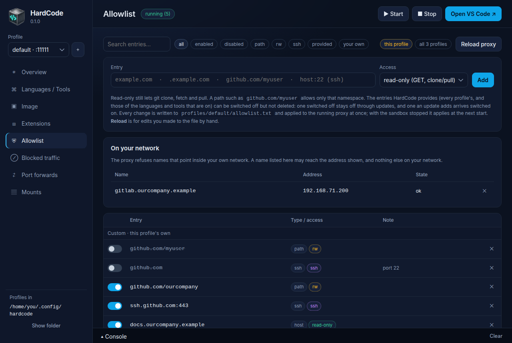
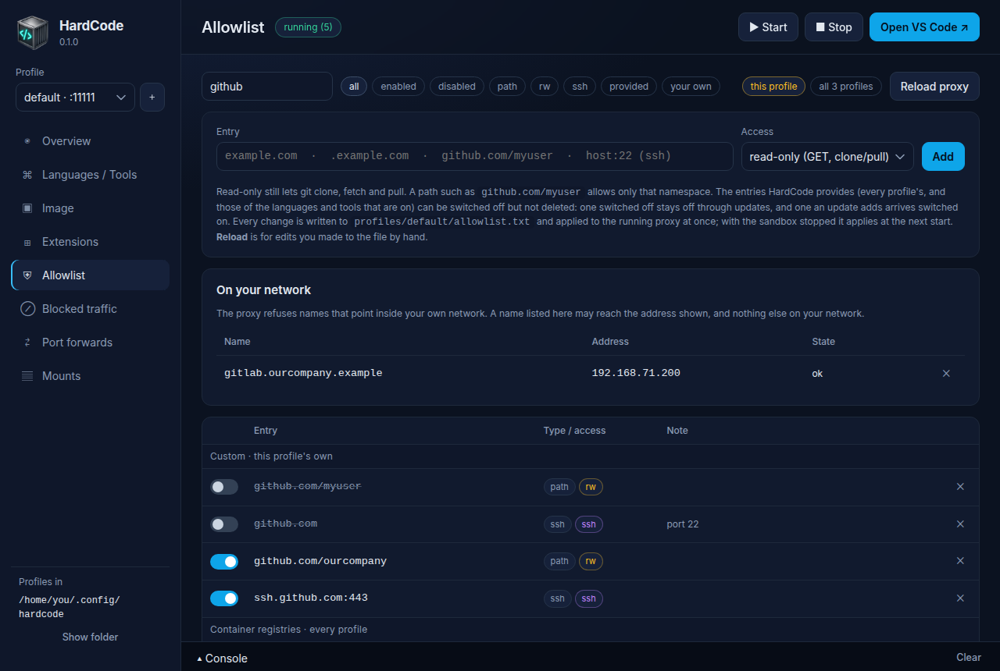
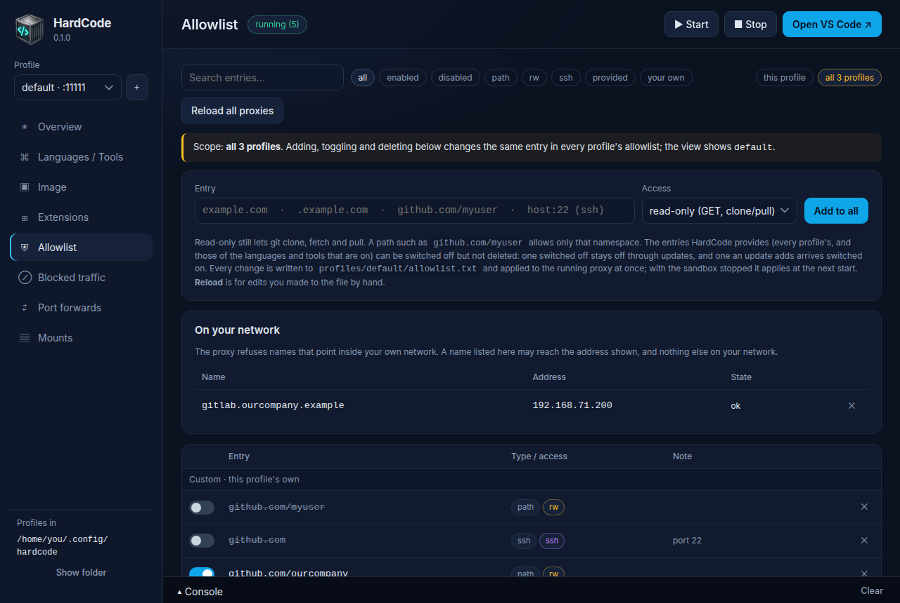
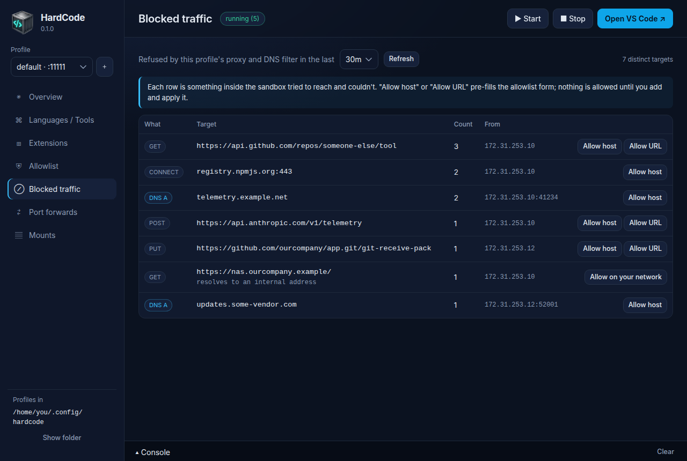

# The allowlist

A profile's **allowlist** decides what its sandbox can reach on the
internet. Anything that isn't on it is refused: web traffic by HardCode's
proxy, name lookups by its DNS server. Each line of the allowlist is an
**entry**, such as `github.com/your-org`.

Entries are **read-only** unless they say otherwise: the sandbox can
download from them (and clone, fetch and pull with git), but not upload.
An entry marked **`rw`** (read-write) also allows uploads: pushing,
publishing, calling an API with `POST`. An entry marked **`ssh`** allows an
SSH connection to a host.

Because the proxy looks inside HTTPS, an entry can be a single path on a
site: `github.com/your-org` allows your organisation's repositories, and
nothing else on GitHub.

## What a new profile allows

HardCode provides the entries a sandbox needs to work, in blocks:

- **every profile** gets VS Code's own hosts (its updates and the
  extension Marketplace), the Ubuntu, Debian and Alpine package mirrors,
  the common container registries (read-only: images can be pulled, never
  pushed), and GitHub's raw file downloads (`raw.githubusercontent.com`);
- **each language** you switch on adds its package registries, read-only:
  PyPI for Python, npm for JavaScript, and so on;
- **each coding agent** you switch on adds the hosts it talks to: the
  Claude Code CLI its API and sign-in hosts, the Codex CLI OpenAI's.

No block opens a git host: you add the places you work in. The full list
is [below](#what-hardcode-provides).

## See the allowlist



**In the app**, open **Allowlist**. The profile's own entries come first,
under *Custom · this profile's own*, so one you add is in sight; then
HardCode's, block by block (*VS Code · every profile*, then *Python ·
comes with the language* and so on).
Each row shows the entry's type (host, subdomains, path, ssh) and access
(read-only, `rw`, `ssh`). Search and the filter buttons narrow the list:
*provided* and *your own* show just those.



**With the command:**

```sh
hardcode allowlist
```

## Allow something

**In the app:**

1. Open **Allowlist**.
2. Type the entry in **Entry**: `github.com/your-org`, say.
3. Choose its **Access**: *read-only (GET, clone/pull)*, *read-write
   (uploads, push)* or *ssh tunnel*.
4. Click **Add**.

**With the command:**

```sh
hardcode allow github.com/your-org              # read-only
hardcode allow github.com/your-org/app rw       # read-write
```

The change applies at once: a running sandbox's proxy reloads with it
within seconds (the app says *proxy reloaded*). With the sandbox stopped,
it applies at the next start.

Some entries you may want:

| To | Entry |
|---|---|
| clone and pull your repositories on GitHub | `github.com/your-name` |
| push to one repository | `github.com/your-name/app rw` |
| use GitHub's API for your repositories | `api.github.com/repos/your-name` |
| use Claude Code's official plugin marketplace (a GitHub repository) | `github.com/anthropics/claude-code` |
| call an API that takes `POST` requests | `api.example.com rw` |
| reach a host and all its subdomains | `.example.com` |
| use SSH to GitHub, if you must | `ssh.github.com:443 ssh` |

Keep entries as narrow as you can: a path rather than a host, read-only
rather than `rw`, HTTPS rather than `ssh`.
[Staying safe](staying-safe.md#keep-the-allowlist-narrow) says why.

## Stop allowing something

**In the app**, the switch at the start of a row turns an entry off and
on again; **✕** deletes one of the profile's own. **With the command:**

```sh
hardcode deny github.com/your-org               # off (the line stays, commented out)
hardcode allowlist enable github.com/your-org   # back on
hardcode allowlist remove github.com/your-org   # deleted
```

An entry HardCode provides can be switched off but not deleted: deleted,
it would come back with its block. Switched off, it stays off through
every update and through switching its language off and on again.



With more than one profile, the app's **all N profiles** button makes
adding, switching and deleting apply to every profile; the command's
`--all` does the same (`hardcode --all allow github.com/your-org`).

## When something is blocked



**Blocked traffic** in the app, or `hardcode blocked` in a terminal, lists
what the profile's proxy and DNS server refused, most frequent first:

```sh
hardcode blocked                  # the last 30 minutes
hardcode blocked --since 24h      # or 10m, 2h
```

What a row tells you:

| Row | Means |
|---|---|
| `CONNECT host:443` | The host isn't on the allowlist at all. |
| `GET` or `HEAD` with a URL | No entry allows that URL: the host is allowed, but not that path (or, for a plain `http://` address, the host isn't on the list). |
| `POST`, `PUT`, `PATCH` or `DELETE` to an allowed URL | The entry is read-only: uploading there needs `rw`. |
| `DNS A`, `DNS AAAA` | A lookup of a name that isn't allowed: it was answered "no such name" without leaving your computer. |

In the app, **Allow host** and **Allow URL** fill in the allowlist form
with the row's host, or its URL's folder. Nothing is allowed until you
click **Add**. Before you do, read
[what to ask about a blocked row](staying-safe.md#read-blocked-traffic-before-you-allow-anything):
most refusals are telemetry, and better left blocked.

If something still fails after you allowed it, check the entry's kind: a
path entry (`host/path`) allows only that path.

## Edit the file by hand

The profile's own entries are in its `allowlist.txt`
([where it is](profiles.md#where-profiles-are)). It has two sections:

- **Custom**: your entries, one per line. `hardcode allow` and the app add
  here. It starts with commented-out examples for git hosting.
- **Switched off**: an `off <entry>` line (`off <host[:port]> ssh` for an
  SSH one) for each entry HardCode provides that this profile doesn't
  allow.

After editing it, give the proxy the new list: **Reload proxy** on the
app's Allowlist page, or `hardcode reload`. An invalid line stops the
proxy from starting, so the reload says so; the app marks the line
*invalid*, and `hardcode allowlist` flags it.

## Entry format

One entry per line; `#` starts a comment; blank lines and spacing are
free; case doesn't matter.

```
example.com                 # that host, any URL
.example.com                # that host and every subdomain
github.com/myuser           # only URLs under that path: /myuser and /myuser/…
github.com/myuser   rw      # … and uploads (POST, PUT, PATCH, DELETE; git push) too
github.com          ssh     # an SSH tunnel to github.com:22
ssh.github.com:443  ssh     # … or to another port
```

| Form | Matches | Rules |
|---|---|---|
| `host` | `http(s)://host[:port]/…` | a name with at least two labels; each label letters, digits and inner hyphens. A bare top-level name (`com`) is refused, and so is an address (`127.0.0.1`): the proxy matches names. One trailing dot is accepted. |
| `.host` | `host` and every subdomain | can't have a path |
| `host/prefix` | URLs whose path is `/prefix`, or starts with `/prefix/` or `/prefix?` | no `?`, `#` or `:` in the prefix, and no `.` or `..` segments |
| `… rw` | the same URLs, with every method | the only other flag is `ssh`; read-only is the default, not a flag |
| `host[:port] ssh` | an SSH tunnel to that host and port (22 by default) | no wildcard, no path; a colon must be followed by a port from 1 to 65535 |
| `off <entry>`, `off <host[:port]> ssh` | nothing: switches off an entry HardCode provides | |

Anything else is an error: the command and the app refuse it, and the
proxy won't start with it rather than run with part of the list. Typed
entries are tidied before they are written (case, trailing dots and
slashes: `host/` is just `host`). A file whose last line has no newline is
read whole.

**An empty allowlist allows nothing.** Switch off or remove every entry
and the proxy refuses everything and the DNS server answers no name; it
doesn't keep the previous rules.

### Read-only and `rw`

Without `rw`, an entry allows `GET`, `HEAD` and `OPTIONS`, and the one
`POST` git uses to clone, fetch and pull (`…/git-upload-pack`). So:

- package registries and container registries can be downloaded from,
  but not published or pushed to;
- a git path can be cloned and pulled, but not pushed to (a push is a
  `POST` to `…/git-receive-pack`);
- an API that takes `POST` needs `rw`: the Claude API, the VS Code
  Marketplace's search, sign-in pages.

### Paths

A path entry is checked against the request as it is sent, and a server
may tidy a path it receives (`/your-org/../other` becomes `/other`). So
the proxy refuses, in every request whatever the entry, a path containing
a dot segment (`/../`, `/./`, also `%2e`-encoded or followed by an encoded
slash, or `..;`) or a backslash (plain or `%5c`). Names with dots in them,
such as `/.well-known/`, are fine, and so is an encoded slash on its own
(npm's `/@scope%2fname`).

### Addresses inside your network

Once a request has passed the name and URL checks, the proxy looks the name
up and refuses it if it points at loopback, link-local (where cloud
metadata services are), private or shared address space (the profile's
`EGRESS_INTERNAL_RANGES` setting). So an allowed name can't be used to
reach your computer, your local network or a cloud metadata service.

### SSH

SSH is passed through, not inspected, so an `ssh` entry is a **whole host,
read-write**: paths and read-only only exist over HTTPS. Inside the
sandbox, `ssh` and `git@…` addresses go through the proxy by themselves,
and the proxy refuses the tunnel unless the host has an `ssh` entry. An
`ssh` entry and an HTTPS entry for the same host are separate entries:
`hardcode deny`, `allowlist enable`, `disable` and `remove` take `ssh` at
the end to mean the SSH one (`hardcode deny github.com ssh`).

### DNS

The sandbox's only DNS server looks up exactly the names on the
allowlist, and their subdomains (a name's subdomains are served by the
same operator's name servers), including `.wildcard` entries and `ssh`
hosts. Every other name is answered "doesn't exist" by the server itself
and logged, so a lookup can't carry data out, and a name that isn't
allowed never leaves your computer.

## What HardCode provides

The entries HardCode provides are written down in one place in HardCode
itself, and added to each profile's own entries whenever the proxy is
given its rules. Entries are read-only unless marked `rw`.

**Every profile:**

| Block | Entries |
|---|---|
| VS Code | `update.code.visualstudio.com`, `vscode.download.prss.microsoft.com`, `download.visualstudio.microsoft.com`, `marketplace.visualstudio.com`, `marketplace.visualstudio.com/_apis/public/gallery` `rw` (extension search is a `POST`), `.gallery.vsassets.io`, `.gallerycdn.vsassets.io`, `.vscode-cdn.net` |
| OS package mirrors | `.archive.ubuntu.com`, `security.ubuntu.com`, `ports.ubuntu.com`, `deb.debian.org`, `security.debian.org`, `dl-cdn.alpinelinux.org` |
| Container registries | Docker Hub (`registry-1.docker.io`, `auth.docker.io`, `production.cloudfront.docker.com`, `docker-images-prod.6aa30f8b08e16409b46e0173d6de2f56.r2.cloudflarestorage.com`), GitHub Container Registry (`ghcr.io`, `pkg-containers.githubusercontent.com`), Quay (`.quay.io`, `quayio-production-s3.s3.amazonaws.com`), Red Hat (`registry.access.redhat.com`, `registry.redhat.io`), Microsoft (`mcr.microsoft.com`, `.data.mcr.microsoft.com`), Google (`.gcr.io`, `.pkg.dev`), Kubernetes (`.registry.k8s.io`), AWS ECR Public (`public.ecr.aws`, `d5l0dvt14r5h8.cloudfront.net`) |
| GitHub raw files | `raw.githubusercontent.com` |

**With a language or tool switched on:**

| Language or tool | Entries |
|---|---|
| Python | `pypi.org`, `files.pythonhosted.org` |
| JavaScript / TypeScript | `registry.npmjs.org`, `registry.yarnpkg.com`, `repo.yarnpkg.com` |
| Java | `repo.maven.apache.org`, `repo1.maven.org`, `services.gradle.org`, `downloads.gradle.org`, `plugins.gradle.org`, `plugins-artifacts.gradle.org` |
| Android | Google's SDK packages and Maven repository, as paths on `dl.google.com` rather than the whole host: `dl.google.com/android/repository`, `dl.google.com/dl/android/maven2`, and `maven.google.com`, which redirects there; the three copies of F-Droid's signed log of the SDK's checksums, which `sdkmanager` checks every package against: `f-droid.github.io/android-sdk-transparency-log`, `fdroid.gitlab.io/android-sdk-transparency-log` and `raw.githubusercontent.com/f-droid/android-sdk-transparency-log`; then Java's entries, so that Android builds with Java off |
| C# / .NET | `api.nuget.org`, `globalcdn.nuget.org`, `builds.dotnet.microsoft.com` |
| Go | `proxy.golang.org`, `sum.golang.org`, and the module proxy's own storage, which it sends the larger modules and newer Go toolchains from: `storage.googleapis.com/proxy-golang-org-prod` |
| Rust | `crates.io`, `index.crates.io`, `static.crates.io`, `static.rust-lang.org`, and for the CodeLLDB debugger's own downloads, that one project's releases on GitHub: `github.com/vadimcn/codelldb/releases/download` and `release-assets.githubusercontent.com/github-production-release-asset/49407251` |
| Ruby | `rubygems.org`, `index.rubygems.org` |
| Perl | `www.cpan.org`, `cpan.metacpan.org`, `fastapi.metacpan.org`, `cpanmetadb.plackperl.org` |
| Claude Code CLI | `api.anthropic.com` `rw` (the API), `claude.ai` `rw` (sign-in), `platform.claude.com` `rw` (sign-in), `claude.com` (sign-in page), `downloads.claude.ai` (installer and updates) |
| Codex CLI | `auth.openai.com` `rw` (sign-in), `chatgpt.com/backend-api` `rw` (the model, with a ChatGPT plan), `api.openai.com` `rw` (the model, with an API key) |

C / C++, Build essentials and the Docker CLI open nothing. The coding
agents' telemetry and error-reporting hosts are never opened
([the security model](security.md#the-coding-agents) has more).

Switching a language or tool on or off (on the app's **Languages /
Tools** page, or `hardcode enable` and `disable`) brings its block or
takes it away, and a running proxy reloads at once. It doesn't touch
`allowlist.txt`: an entry you switched off stays off.

An entry of your own that a block also provides is allowed as long as
either is on. To allow more than a block does (`rw` where it is
read-only), add an entry of your own beside it: `hardcode allow pypi.org
rw`.

**Updates reach every profile.** A profile stores only its own entries and
the provided ones it switched off, so a newer HardCode's blocks apply to it
as they are: an entry added to a block arrives switched on, one dropped
from it goes, and one whose access changed follows. That happens at the
profile's next `up`, `start`, `restart`, `rebuild` or `reload`, which
print what changed (`allowlist: Rust: + newrustsite.com`). On Kubernetes
it happens at the operator's next pass after an upgrade.

## How edits are made

Edits change single lines and keep the file's comments, sections and
order. `hardcode allow` of an entry that is there but commented out
uncomments it in place (and updates its flag); a new entry goes at the end
of the Custom section. `allow` of a provided entry changes nothing, or
switches it back on if it was off; `remove` of one is refused. `allow
github.com` adds an HTTPS entry and leaves the template's commented
`#github.com ssh` example alone. `deny` of an entry that isn't on is an
error for one profile; with `--all`, each profile without it says so and
the others go ahead.

Every edit writes `allowlist.txt`, then `proxy-allowlist.txt` from it.
When the profile is running, the proxy is then recreated with the new rules
and HardCode waits for it to be healthy; the DNS server picks up its new
list within 10 seconds. If the proxy doesn't come back healthy, the
command fails (the edit is kept) and says to look at
`hardcode logs allowlist squid`: until then, which rules are in force is
unknown.

A running proxy keeps the rules it loaded, whatever the file says since,
so HardCode records what it saw the proxy load
(`proxy-allowlist.applied`). A start or rebuild that finds the proxy
running with anything else reloads it: an edit whose reload failed is put
right by the next start that succeeds.

## How the rules are enforced

For the curious:
[`images/squid/allowlist-render.sh`](../images/squid/allowlist-render.sh)
turns the profile's list into these files before the proxy and the DNS
server start:

| File | Content |
|---|---|
| `squid/hosts.txt` | the hosts tunnels may go to and HTTPS may be opened for (`.host` for wildcards; hosts a wildcard already covers are dropped) |
| `squid/urls-ro.regex`, `squid/urls-rw.regex` | one `^https?://host(:[0-9]+)?/prefix(/|\?|$)` pattern per entry |
| `squid/ssh.conf` | `http_access allow CONNECT host port` and `on_unsupported_protocol tunnel` for each `ssh` entry |
| `Corefile` | one forwarding block listing every allowed name (none when the list is empty), and a catch-all that answers "doesn't exist" and logs |

[`squid.conf`](../images/squid/squid.conf) ties them together: tunnels
only to `hosts.txt`; HTTPS opened (`ssl_bump peek`, then `bump`) when the
server name is on the list, closed (`terminate`) otherwise; paths with dot
segments or backslashes refused first; `url_rw` for every method, `url_ro`
for the read methods and `git-upload-pack`; everything else denied, and
refused tunnels reset. `cli/hardcode_cli/allowlist.py` and the render
script are both run over `tests/allowlist-corpus.txt`, so they can't
disagree about what an entry means, and `tests/proxy.py` runs this
configuration for real.
