# The desktop app

The HardCode app is a window onto your profiles, for Linux, macOS and
Windows: start and stop sandboxes, open VS Code, choose languages and
tools, and see and change what each sandbox may reach. Everything it does
is a [`hardcode` command](cli.md) underneath, run by its own copy of the
command, on the same profiles: you can use both, and switch between them
whenever you like.

[Getting started](getting-started.md) covers installing it and your first
profile.

## The window

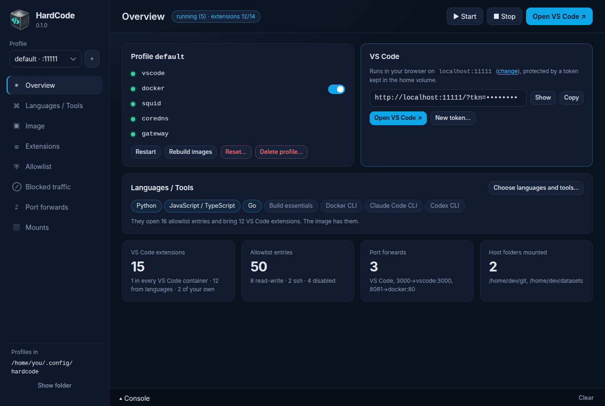

- **The sidebar** has, from the top: the app's version under its name;
  the **profile list**, with the port each profile's VS Code is on, and
  **＋** for a new profile; the pages (Overview, Languages / Tools,
  Extensions, Allowlist, Blocked traffic, Port forwards, Mounts); and at
  the bottom, under **Profiles in**, the folder your profiles are kept in,
  with **Show folder** to open it (to edit a profile's files by hand).
- **The top bar** shows the profile's state and the **▶ Start**,
  **■ Stop** and **Open VS Code ↗** buttons.
- **The Console** at the bottom opens by itself while a long command
  (starting, rebuilding, resetting, deleting) shows its progress. Its
  **■ Stop** button stops the command and everything it started.

The state next to the page title says:

| State | Means |
|---|---|
| *running (5)* | every container runs (with Docker switched off, four) |
| *2/5 running* | some containers run, some don't: the Overview shows which |
| *stopped* | the sandbox exists but isn't running |
| *not created* | the sandbox hasn't been started yet, or was removed |
| *docker not found* | the `docker` command can't be found |
| *docker not running* | Docker doesn't answer: start Docker Desktop, or the Docker service |
| *status unknown* | Docker Compose or the command failed; hover over it for the reason |

While the sandbox installs VS Code extensions, the state adds how far it
has got: *running (5) · extensions 3/12*.

The app opens on the profile you used last. Closing the app doesn't stop
any sandbox.

## Overview

The profile at a glance.

**The containers**: `vscode` (where VS Code and your tools run), `docker`
(the Docker daemon beside it), then the plumbing: `squid` (the proxy),
`coredns` (the DNS server) and `gateway` (which publishes VS Code and your
port forwards on your computer). The dot beside each says how it is:

| Dot | Means |
|---|---|
| green | running and healthy |
| amber | starting, restarting or unhealthy |
| red | stopped while the rest of the sandbox runs |
| grey | stopped, or switched off |

A container only has words beside it when something needs a look. Hover
over it for its full status; click it to see its logs.

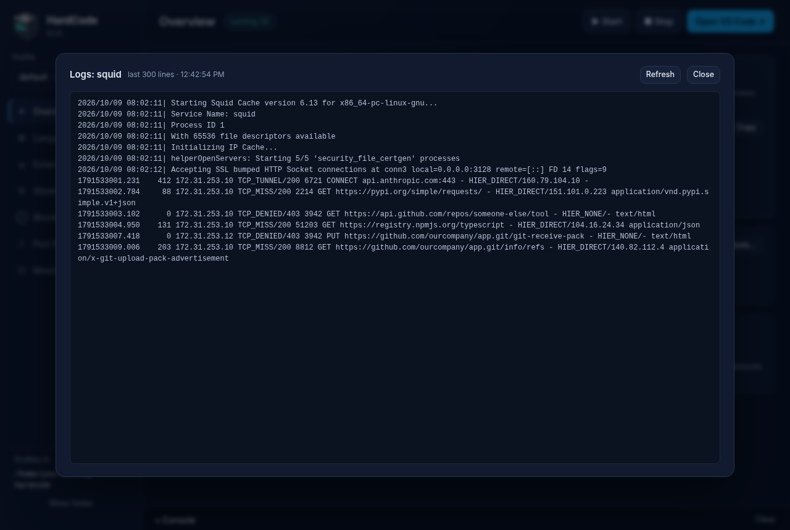

The logs window shows the last 300 lines and keeps reading new ones while
it is open, following the end unless you scroll up. **Refresh** reads them
at once; **Close**, a click outside or Escape closes it.

**The switch on the docker row** turns the profile's Docker daemon on or
off. Off, no daemon runs for the profile and `docker` has nothing to talk
to: the [harder sandbox](staying-safe.md#use-the-harder-sandbox-when-you-can).
A running sandbox is changed at once (VS Code's container is recreated).

**The buttons under the containers:**

| Button | Does |
|---|---|
| **Restart** | restarts every container; nothing is lost |
| **Rebuild images** | builds the profile's images again, then starts the sandbox with them |
| **Reset…** | after asking, deletes the containers and all the sandbox's storage: the home folder, `/shared`, the images pulled with Docker inside, the proxy's certificate. The profile's settings and its images stay. |
| **Delete profile…** | after asking, deletes the profile entirely: containers, storage, image and settings. If it was the last one, the app asks for a new first profile. |

**The VS Code card** says which port VS Code is on, with **change** to
move it to another (refused for a port another profile uses; a running
profile moves at once). Below is VS Code's address, with its token hidden:
**Show** reveals it, **Copy** copies the whole address, and **Open VS
Code ↗** opens it. **New token…** replaces the token after asking: every
copy of the old one stops working, and VS Code restarts, so open windows
need the new address. The address appears once the sandbox's VS Code is
up; until then the box says why there is none.

**The Languages / Tools card** lists what the profile is built around, and
what they open and bring. **Choose languages and tools…** goes to that
page. When the image was built with other languages or tools than the
profile now has, a warning names the difference, with **Rebuild image**.

**The counts** at the bottom: VS Code extensions (those every sandbox has,
the languages', and your own), allowlist entries (with how many are
read-write, `ssh` or switched off), port forwards and shared folders.

## Languages / Tools

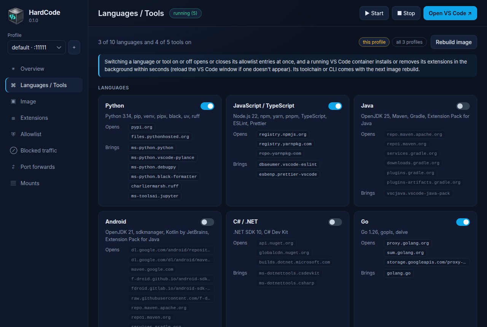

A card for each language, then each tool, with its switch, what it
installs, the allowlist entries it **opens** (one switched off in the
allowlist is struck through) and the VS Code extensions it **brings**.

A switch changes three things, at different times, as the banner says:

1. **The allowlist entries** open or close at once, and a running proxy
   reloads.
2. **The extensions** follow within seconds, while VS Code runs (reload
   VS Code's window if one doesn't appear).
3. **The software** comes with the next image rebuild. Until then the card
   says *not in the image yet* or *still in the image*, and a warning
   offers **Rebuild image**, which rebuilds it (a few minutes, shown in
   the Console) and recreates VS Code's container. Without the warning,
   **Rebuild image** is at the top of the page.

Before the first start there is no image yet: it is built with the chosen
languages and tools at the first **▶ Start**.

**Ubuntu packages**, below the tools, adds packages of your own to the
image: type a name and click **Add**; **✕** removes one. The next
rebuild installs them, and **Rebuild image** appears until then.

## Extensions

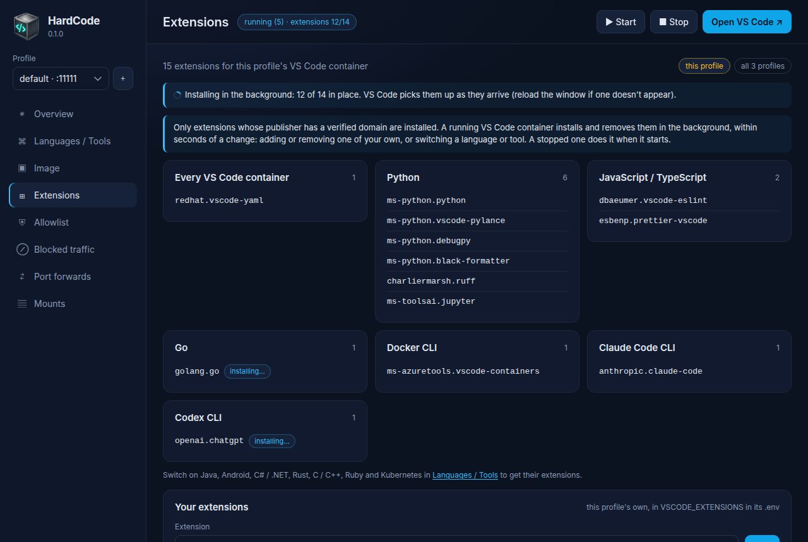

Every VS Code extension the profile's VS Code gets, grouped by what brings
it: **Every VS Code container**, each language or tool that is on, and
**Your extensions**, the profile's own. A line names the languages and
tools that are off and would bring some.

To add one of your own, type its id (`publisher.name`, as the Marketplace
shows it on the extension's page) and click **Add**; **✕** removes it.
Nothing restarts: a running sandbox installs or removes it in the
background within seconds, and a stopped one does it as it starts. An id
that can't be added is explained under the form; one a language already
brings isn't added twice.

Only extensions whose publisher has a verified domain are installed. While
the sandbox runs, each extension shows its state: *installing…*,
*refused: publisher has no verified domain*, or *couldn't install; tried
again shortly*; nothing once it is in place. A line at the top says how
many are in place while they install, and the top of the page says *all 12
installed* once they are.

## Allowlist

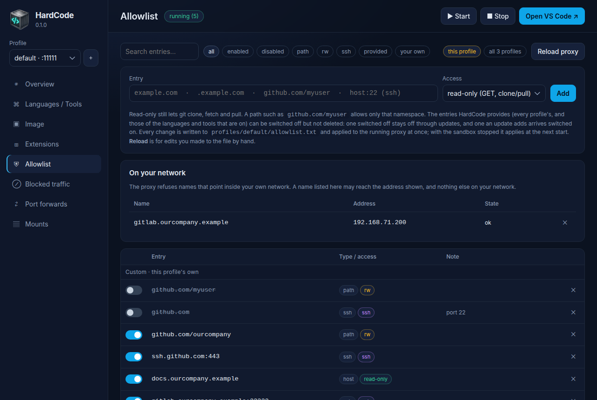

Every entry in the profile's allowlist. Your own entries come first
(*Custom · this profile's own*), then HardCode's, grouped by where they
come from (*VS Code · every profile*, *Python · comes with the
language*, and so on).
Each row has its type (host, subdomains, path, ssh), its access
(read-only, `rw`, `ssh`) and a note.

- **Add**: type an entry, choose its **Access** (*read-only (GET,
  clone/pull)*, *read-write (uploads, push)* or *ssh tunnel*) and click
  **Add**. The entry appears in the list straight away, marked
  *adding…*, and is ready a few seconds later. If HardCode can't use
  it, it goes back into the box with the reason.
- **The switch** at the start of a row turns an entry off or back on.
- **✕** deletes one of the profile's own. A provided entry has no ✕
  (deleted, it would come back with its block): switch it off instead, and
  it stays off through updates. A language's entries have a button that
  goes to Languages / Tools in its place.
- **Search** and the filter buttons (*all*, *enabled*, *disabled*,
  *path*, *rw*, *ssh*, *provided*, *your own*) narrow the list.
- **On your network** lists the names that may reach an address on
  your network, such as a GitLab at home. When you add a name that
  points inside your network, a dialog asks whether to let it reach
  that address; yes adds it here. A row marked *now resolves to …* has
  a **Move** button, and **✕** removes one
  ([a server on your own network](allowlist.md#a-server-on-your-own-network)).

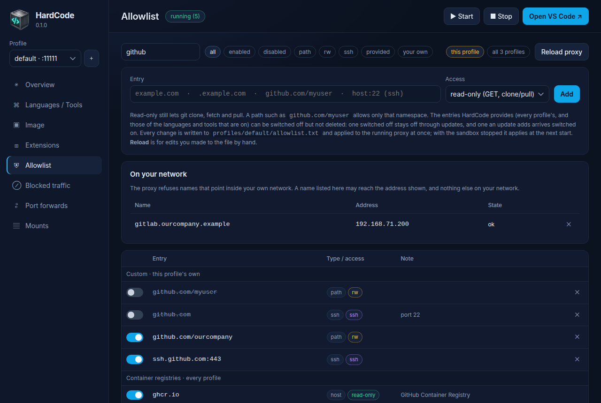

Every change is written to the profile's `allowlist.txt` and applied to a
running proxy at once; the message says *proxy reloaded*, or *applies when
the sandbox starts* when it isn't running. **Reload proxy** is for after
you edited `allowlist.txt` by hand.

[The allowlist](allowlist.md) explains entries in full.

## Blocked traffic

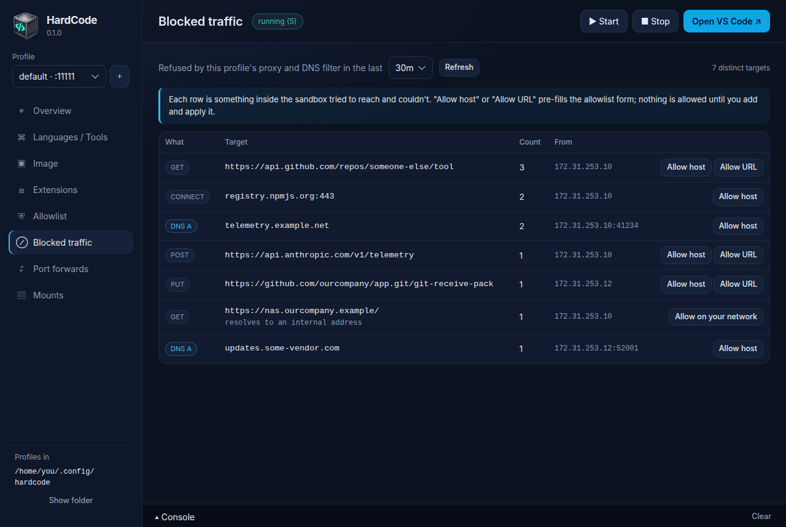

What this profile's proxy and DNS server refused, in the last 10 minutes,
30 minutes, 2 hours or 24 hours (chosen at the top; **Refresh** reads it
again): what was attempted (an HTTP method, `CONNECT`, or a DNS lookup),
where to, how often, and from which address inside the sandbox.

**Allow host** and **Allow URL** fill in the Allowlist page's form with the
row's host, or its URL's folder. Nothing is allowed until you click
**Add** there. A refused `POST` or `PUT` to an allowed host means the entry
would need `rw`; a `CONNECT` means the host isn't on the allowlist at all.
A row that says *resolves to an internal address* is a name that points
inside your network: **Allow on your network** asks whether to let it
reach that address.
Before you allow anything, read
[what to ask about a blocked row](staying-safe.md#read-blocked-traffic-before-you-allow-anything).

## Port forwards

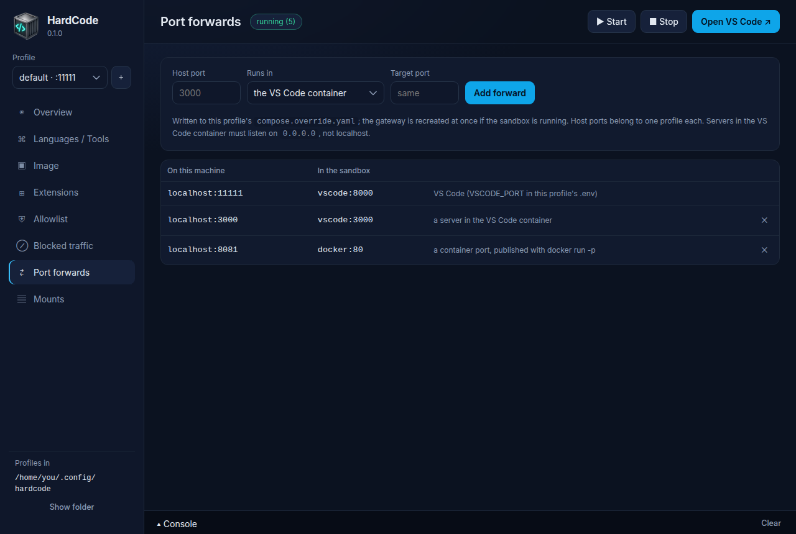

Port forwards let your browser reach a server running in the sandbox, at
`localhost:<port>` on your computer. The first row is VS Code's own.

To add one, give the **Host port** (the port on your computer), choose
where the server **Runs in** (*the VS Code container*, or *a container
(docker run -p)* for a port a Docker container publishes), and the
**Target port** if it differs, then click **Add forward**. A server in
VS Code's container must listen on `0.0.0.0`, not on `localhost`. A port
on your computer belongs to one profile. **✕** removes a forward.

## Mounts

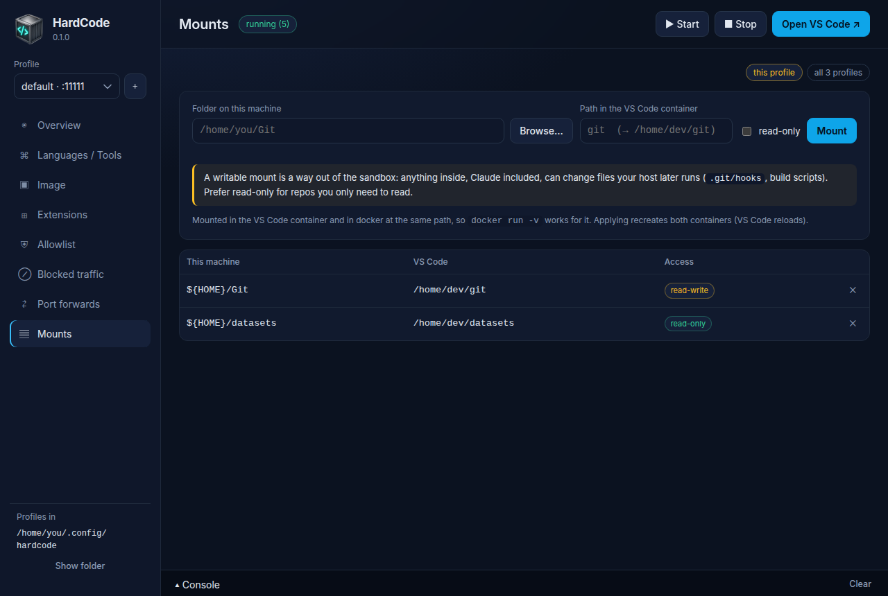

Mounts share a folder from your computer with the sandbox. Choose the
folder with **Browse…**, type where it goes in the sandbox (a name such as
`git` lands in the home folder: `/home/dev/git`), tick **read-only** if
the sandbox only needs to read it, and click **Mount**. VS Code's
container and the Docker daemon see the folder at the same path, so
`docker run -v` works with it too. Adding or removing a mount recreates
both containers (VS Code reloads).

A writable mount is a way out of the sandbox: anything inside, Claude
included, can change files that your computer later runs. Read
[Share folders carefully](staying-safe.md#share-folders-carefully) first.

## Image

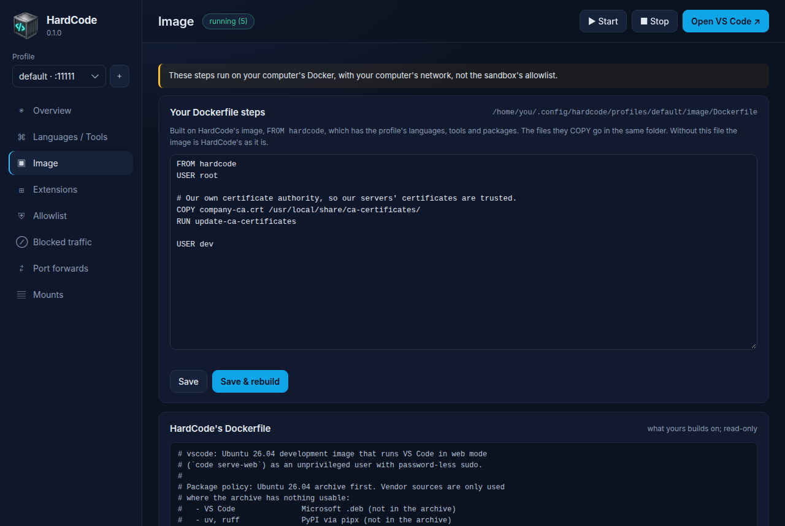

Your own Dockerfile steps, built on top of HardCode's image, for what a
package can't do. A new profile has none: the editor starts with an
example to begin from. **Save** keeps your steps, and **Save & rebuild**
also builds the image, in the Console. Below the editor is HardCode's own
Dockerfile, which your steps build on.

The steps run on your computer's Docker, with your computer's internet
connection, not through the sandbox's allowlist: only add steps you
trust. [Your own packages and steps](vscode-image.md#your-own-packages-and-steps)
has an example.

## Changing every profile at once

With more than one profile, the Languages / Tools, Extensions, Allowlist
and Mounts pages have two buttons at the top: **this profile** and **all N
profiles**. With *all*, a note says so, and switches, additions and
deletions apply to every profile; the page still shows the profile
selected.

## New profile

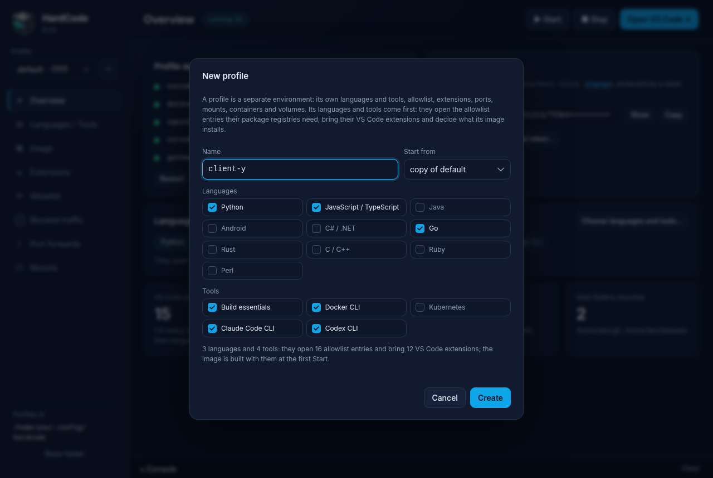

**＋** next to the profile list opens it: a **Name**; **Start from**, *the
template (defaults)* or a *copy of* a profile (its allowlist, settings and
shared folders, with a port and network of its own); and the
**Languages** and **Tools** to build it around, ticked as the source has
them (the template: the five tools, no language). The line underneath adds
up what they open and bring. **Create** makes it and opens it on its
Languages / Tools page; its image is built at its first **▶ Start**.
[Profiles](profiles.md) has more.

The first time the app starts, and after you delete the last profile, the
same window asks for **Your first profile**, named `default`. It can't be
closed without creating one: there is nothing to show without a profile.

## Updates

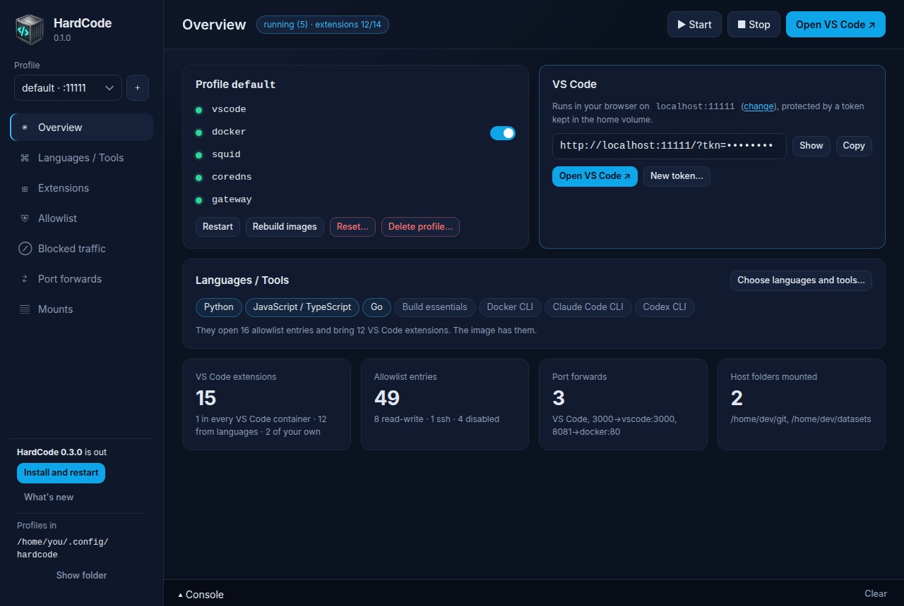

As it starts, the app asks HardCode's GitHub releases whether there is a
newer one. When there is, the sidebar says so: **What's new** opens the
release's page, and **Install and restart** downloads it, checks that it
is signed with the key the app trusts and is the version announced,
installs it and starts the new app. Your sandboxes keep running meanwhile.
Offline, nothing is shown, and the app asks again next time. A build you
made yourself has no updater.

After updating, rebuild your profiles (**Rebuild images** on the
Overview) so they run the newer images.

## Where the app keeps its settings

The profiles are in HardCode's home ([where](profiles.md#where-profiles-are)).
Start the app with `--config DIR` (or set `HARDCODE_CONFIG`) to use
another folder; the app passes it on to the command.

The app itself remembers only the profile you used last, in its settings
file: `~/.config/io.github.hardcode-app.hardcode/settings.json` on Linux,
in `~/Library/Application Support/io.github.hardcode-app.hardcode/` on
macOS, and in `%APPDATA%\io.github.hardcode-app.hardcode\` on Windows.

## For contributors

### How the app finds the command

In order: `$HARDCODE_CLI` (a program, optionally with arguments, such as
`python3 /path/cli/hardcode`); a `hardcode` binary next to the app's own
(releases bundle the PyInstaller build, with the stack it runs profiles
with, as a Tauri sidecar); or, for a development build, `python3
cli/hardcode` in the checkout it was built from. The app is a
[Tauri 2](https://tauri.app) shell (Rust) around a plain HTML and
JavaScript page; every action is one `hardcode --json …` call, streamed to
the Console when it takes a while, so the app has no logic of its own and
the CLI's tests cover its behaviour.

### Building

Like everything here, the app is built in the **build image**
(`images/build/Dockerfile`: Ubuntu 26.04's rustc and cargo and Tauri's
libraries from the archive, the Tauri CLI and PyInstaller pinned).
`app/build.sh` runs each step there through `images/build/run.sh`, which
builds the image on first use, mounts the checkout, caps the container
(`BUILD_MEMORY`, 6g; `BUILD_CPUS`, 4 or what the machine has) and keeps
cargo's and linuxdeploy's caches in `~/.cache/hardcode-build`, so later
runs take seconds:

| Command | Does | Output |
|---|---|---|
| `app/build.sh build` | a debug build | `app/src-tauri/target/debug/hardcode-app` |
| `app/build.sh cli` | the standalone `hardcode` binary (PyInstaller) | `dist/hardcode-linux-<arch>` |
| `app/build.sh wheel` | the CLI's Python package, with its stack (the archive's setuptools; nothing is fetched) | `dist/hardcode_cli-<version>-py3-none-any.whl` |
| `app/build.sh bundle` | the CLI as the app's sidecar, then the installers, then on a Linux desktop the launcher below. The version is the files' (`release/release.py stamp X.Y.Z` writes another); `HARDCODE_UPDATER_CONFIG` adds a release's updater configuration, signed with `TAURI_SIGNING_PRIVATE_KEY` (the release workflow does) | `.deb`, `.rpm` and AppImage under `app/src-tauri/target/release/bundle/` |
| `app/build.sh desktop` | the launcher for the release build, in your app grid (Linux; run on your machine, not in the image) | `~/.local/share/applications/HardCode.desktop` |
| `app/build.sh shell` | a shell in the image with the checkout and caches mounted | |

On a Linux desktop, `app/build.sh bundle` then writes a **launcher** for
the build, as `app/build.sh desktop` does on its own: `HardCode.desktop` in
`~/.local/share/applications` (your user only; the `.deb`'s file name, so
a system install beside it doesn't make two entries), pointing at
`app/src-tauri/target/release/hardcode-app`, with the app's icon in
`~/.local/share/icons`. Start HardCode from the app grid and the dock shows
its icon: GNOME matches a window (the app's is `hardcode-app`) to an
installed `.desktop` file, and on Wayland ignores the icon a window sets
itself, so a binary started from a terminal gets a generic one. The
launcher keeps pointing at the release build, so each bundle is picked up
without installing anything again.

The app isn't run from the container: it drives Docker on the machine it
runs on. Install the `.deb` or run the AppImage. The release workflow
builds the same Linux bundles in the same image; macOS and Windows
installers are built on those platforms. `tests/app.py` tests the app
([Testing](testing.md)).

### Layout

```
app/src/index.html     the page
app/src/app.js         views and actions; talks to window.hardcode
app/src/bridge.js      window.hardcode on top of Tauri: every channel is one `hardcode --json` call
app/src/styles.css     the stylesheet (shared with the admin UI)
app/src-tauri/         Rust: finds and runs the CLI, streams output, stores settings, checks for and installs updates; Tauri config, icons, capabilities
```
