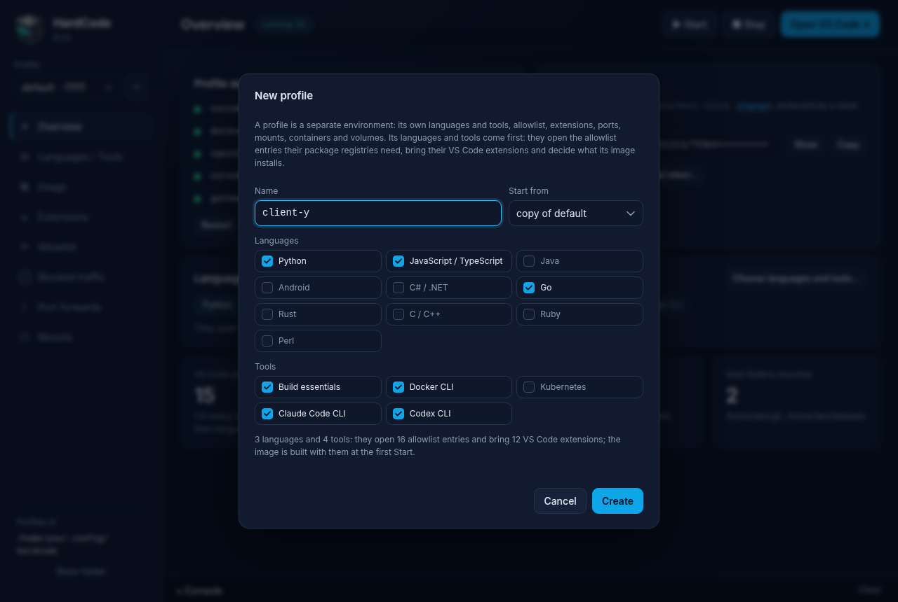
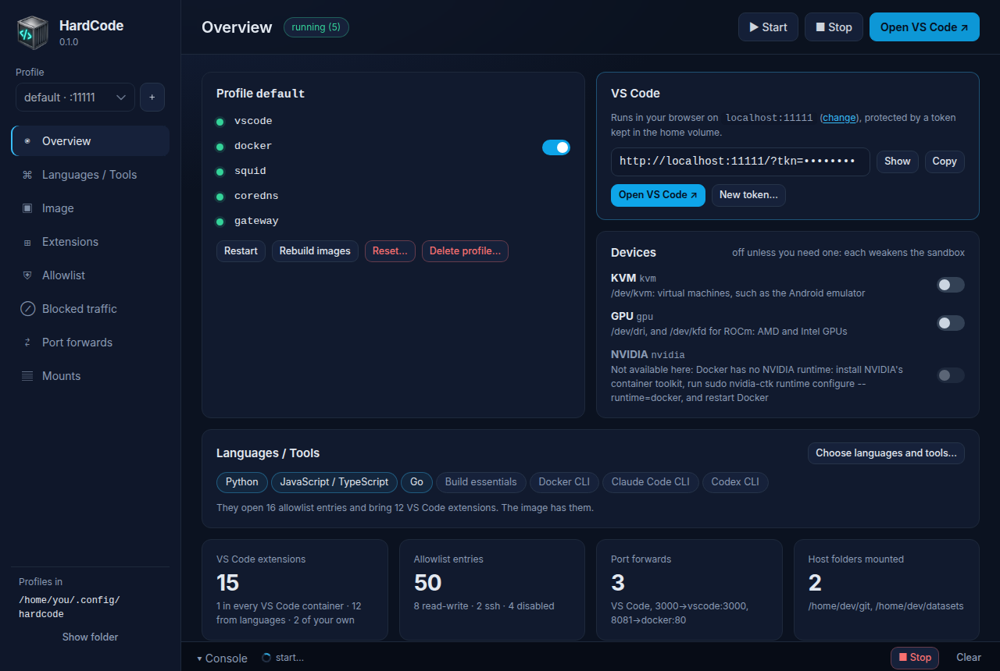

# Getting started

This page takes you from nothing to Claude Code running safely in a
HardCode sandbox. You don't need to be a developer to follow it: every step
says what to click or what to type.

By the end you will have a **sandbox**: a sealed-off environment on your
computer, with VS Code (a code editor) open in your web browser and Claude
Code ready in its terminal. What runs in the sandbox can't see your files
unless you share a folder with it, and it can reach only the internet
addresses on its **allowlist**, the list of what it is allowed to reach.
HardCode calls each sandbox, with its settings, a **profile**. Your first
one is called `default`.

## 1. Install Docker

HardCode runs everything in Docker containers, so Docker comes first. You
need **Docker 28 or newer** with **Docker Compose v2**. Older versions of
Docker lack the network isolation HardCode relies on, so don't skip the
check at the end of this step.

- **macOS and Windows**: install
  [Docker Desktop](https://docs.docker.com/desktop/) and start it. It has
  to be running whenever you use HardCode.
- **Linux**: install Docker Engine as
  [Docker's instructions](https://docs.docker.com/engine/install/) say for
  your distribution, then follow its
  [post-installation steps](https://docs.docker.com/engine/install/linux-postinstall/)
  so that you can run `docker` without `sudo`. HardCode never needs root
  and refuses to run under `sudo`.

Then check the versions. Open a terminal (Terminal on macOS, PowerShell on
Windows) and type:

```sh
docker version           # under "Server", the Engine's "Version" must be 28 or higher
docker compose version   # must say v2 (or higher)
```

If `docker version` says it can't connect to the Docker daemon, Docker
isn't running yet: start Docker Desktop, or the Docker service on Linux.

On Linux other than Ubuntu 23.10 or newer, HardCode's Docker daemon may
need one extra setting to start; if it does,
[Troubleshooting](troubleshooting.md#the-docker-container-keeps-restarting)
says which.

## 2. Install HardCode

There are two ways to use HardCode. They share the same profiles, so you
can switch between them at any time.

- **The desktop app**: a window with buttons for everything. Choose this
  if you're not sure.
- **The `hardcode` command**: for your terminal and your scripts.

### The desktop app

Download the installer for your computer from the
[Releases page](https://github.com/hardcode-app/hardcode/releases):

| Your computer | Download |
|---|---|
| Windows | the `-setup.exe` (or the `.msi`) |
| macOS with Apple silicon (M1 or later) | the `.dmg` |
| Ubuntu, Debian | the `.deb` |
| Fedora, openSUSE | the `.rpm` |
| any other Linux | the `.AppImage` |

Install it as you would any other app. It carries its own copy of the
`hardcode` command, so there is nothing else to install.

HardCode's installers aren't signed by Apple or Microsoft yet, so the first
time you open the app your computer warns you:

- **macOS** refuses to open it (it may say the app is damaged, or that
  Apple can't check it). After copying HardCode to Applications, open
  Terminal and run
  `xattr -dr com.apple.quarantine /Applications/HardCode.app`, then open
  it again.
- **Windows** shows *Windows protected your PC*. Click **More info**, then
  **Run anyway**.

Each release also has a `SHA256SUMS` file with every file's checksum. On
Linux, `sha256sum -c SHA256SUMS --ignore-missing` in the folder you
downloaded to checks that your download is what was published. With
GitHub's [`gh`](https://cli.github.com/) command, on any computer,
`gh attestation verify <the file> --repo hardcode-app/hardcode` checks
that HardCode's own release workflow built it.

### The `hardcode` command

Download the one file for your computer from the
[Releases page](https://github.com/hardcode-app/hardcode/releases):
`hardcode-linux-x64`, `hardcode-macos-arm64` or `hardcode-win-x64.exe`.
Rename it `hardcode` (`hardcode.exe` on Windows) and put it in a folder on
your `PATH`; on Linux and macOS, make it executable too
(`chmod +x hardcode`). On macOS, also run
`xattr -d com.apple.quarantine hardcode`, or macOS refuses to run it: like
the app, it isn't signed by Apple yet.

On any other computer (an Intel Mac, Linux on ARM), install the Python
package instead. It needs Python 3.9 or newer and
[pipx](https://pipx.pypa.io/):

```sh
pipx install hardcode_cli-<version>-py3-none-any.whl
```

Check that it works:

```sh
hardcode --version
```

## 3. Create your first profile and start it

A profile is built around the **languages** and **tools** you choose.
Each one you choose puts its software in the sandbox, opens the allowlist
entries it needs (a language's package registry, for example) and adds
its VS Code extensions. Choose only what you'll use: you can add more
later, and each one makes the first build longer.

The tools are:

| Tool | What it is |
|---|---|
| Claude Code CLI | Anthropic's coding agent, `claude` in the terminal, with its VS Code extension. **Keep this one** to use Claude Code. |
| Codex CLI | OpenAI's coding agent, `codex` in the terminal, with its VS Code extension. Leave it out if you won't use it: it opens OpenAI's hosts for uploads. |
| Docker CLI | `docker` in the terminal, to run containers inside the sandbox. |
| Kubernetes | Tools for Kubernetes files and Helm charts. Leave it out unless you work with Kubernetes. |
| Build essentials | compilers and libraries that many packages need when they install. |

### With the app



1. Open HardCode. The first time, it asks for **Your first profile**,
   already named `default`. (The picture shows the same dialog when you
   make another profile later.)
2. Under **Languages**, tick the ones you'll use. Not sure? Tick none:
   you can switch languages on at any time.
3. Under **Tools**, all five are ticked. Untick the ones you don't need,
   but keep **Claude Code CLI**.
4. Click **Create**. The app opens the new profile on its
   **Languages / Tools** page.
5. Click **▶ Start** at the top. The **Console** at the bottom opens and
   shows HardCode building the sandbox. The first build takes a few
   minutes, more with several languages.
6. When the status next to the page title says *running*, click
   **Open VS Code ↗**. VS Code opens in your web browser.



### With the command

1. In a terminal, type:

   ```sh
   hardcode up
   ```

2. The first time, it asks what to build the profile around:

   ```
   No profile 'default' yet. Choose what it is built around: the image installs them,
   the allowlist opens their registries, and VS Code gets their extensions.
     languages: python node java android dotnet go rust cpp ruby perl
     tools:     build_essentials docker kubernetes claude_cli codex_cli
   Languages and tools, comma-separated [build_essentials,docker,kubernetes,claude_cli,codex_cli]:
   ```

   Pressing Enter alone gives you the five tools and no language. What you
   type replaces that whole list, so name the tools you want as well as
   the languages: for Python and Claude Code, type
   `python,build_essentials,docker,claude`. Short names work: `claude`,
   `codex`, `js`, `ts`, `c++`, `c#`.
3. HardCode builds and starts the sandbox. The first build takes a few
   minutes, more with several languages.
4. Open VS Code in your browser:

   ```sh
   hardcode open
   ```

## 4. VS Code, in your browser

VS Code runs at `http://localhost:11111/?tkn=…`. Only your own computer
can reach it (`localhost`), and the `tkn=` part is a **token**: a password
in the address. Treat it as one. If it ends up somewhere it shouldn't (a
screenshot, a shared screen), click **New token…** in the app, or run
`hardcode token rotate`, and every copy of the old one stops working.

You can open VS Code again at any time with **Open VS Code ↗** or
`hardcode open`.

## 5. Run Claude Code

1. In VS Code, open a terminal: open the menu (☰, top left) and choose
   **Terminal → New Terminal**.
2. Type `claude` and press Enter.
3. Sign in as Claude Code asks you to. If it shows a link, open the link
   in your browser, sign in there, and paste the code you're given back
   into the terminal.

Your sign-in is kept in the sandbox's home folder, so it survives
restarts. Remember that it is inside the sandbox: anything running there
can use it
([why that matters](staying-safe.md#what-hardcode-cant-protect-you-from)).

The Claude Code extension is in VS Code too. For Codex,
see [signing in to Codex](vscode-image.md#codex).

## 6. Bring in your code

The sandbox starts without your code, and no git host is on its
allowlist. You have two ways to get your code in.

**Clone it inside the sandbox** (the safer way). Allow your GitHub account
or organisation, read-only, so the sandbox can clone and pull from it but
nothing else on GitHub:

```sh
hardcode allow github.com/your-name
```

In the app: **Allowlist**, type `github.com/your-name` in **Entry**, keep
**read-only**, click **Add**. Then, in VS Code's terminal:

```sh
git clone https://github.com/your-name/your-project.git
```

A private repository also needs you to sign in from the sandbox (with a
token limited to that repository, ideally). To push, the repository needs
an `rw` entry: `hardcode allow github.com/your-name/your-project rw`.
[The allowlist](allowlist.md) has more examples.

**Or share a folder from your computer** (a **mount**). The folder appears
inside the sandbox, at `/home/dev/<name>`:

```sh
hardcode mount ~/Projects/my-app my-app --ro
```

In the app: **Mounts**, **Browse…** to the folder, type `my-app` as the
path, tick **read-only**, click **Mount**.

`--ro` (read-only) means the sandbox can read the folder but not change it.
A writable mount is shared both ways: anything in the sandbox, Claude
included, can change files that your computer later runs. Read
[Staying safe](staying-safe.md#share-folders-carefully) before you mount
anything writable.

## 7. See the allowlist at work

In VS Code's terminal:

```sh
curl -I https://marketplace.visualstudio.com   # allowed: every profile has it
curl -I https://example.com                    # refused: not on the allowlist
```

Now open **Blocked traffic** in the app, or run `hardcode blocked`:
`example.com` is there, refused. That page is how you find out what the
sandbox tried to reach. Before you allow anything from it, read
[what blocked traffic tells you](staying-safe.md#read-blocked-traffic-before-you-allow-anything).

## 8. Stop when you're done

Click **■ Stop**, or run `hardcode stop`. Everything you made in the
sandbox stays for next time; **▶ Start** or `hardcode up` brings it back.

Closing the app doesn't stop a sandbox. A running sandbox also starts
again by itself whenever Docker starts (after you restart your computer,
for example), until you stop it.

## Next steps

- [Staying safe](staying-safe.md): what HardCode protects you from, what
  it doesn't, and how to use it so you stay protected. Read it before you
  mount a folder writable or allow anything `rw`.
- [The allowlist](allowlist.md): letting the sandbox reach what it needs,
  and nothing more.
- [Profiles](profiles.md): more sandboxes, each with its own rules.
- [Inside the sandbox](vscode-image.md): what's installed, what is kept
  and what isn't, Docker inside.
- [The desktop app](app.md) and [the `hardcode` command](cli.md), in full.
- [Troubleshooting](troubleshooting.md), when something doesn't work.
