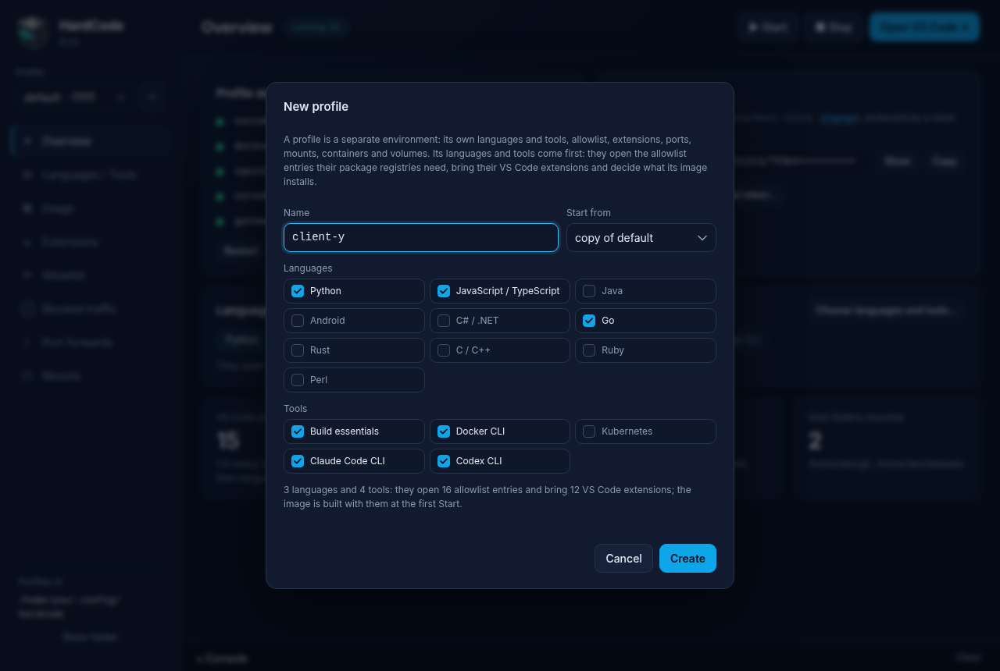

# Profiles

A **profile** is one sandbox with its own settings: its languages and
tools, its allowlist, its VS Code extensions, its port, its shared folders,
and its own containers and storage. Your first profile is `default`. Make
more when you want different rules side by side: a client's code with a
stricter allowlist, a project in another language, an experiment you'll
throw away afterwards.

Profiles don't share containers, networks, storage or certificates, so
what happens in one stays out of the others.

## Make a profile



**In the app:**

1. Click **＋** next to the profile list in the sidebar.
2. Give it a **Name**: lowercase letters, digits and `-`, up to 32
   characters, starting and ending with a letter or digit.
3. In **Start from**, choose *the template (defaults)* for a fresh profile,
   or *copy of* one you have (see [Copy a profile](#copy-a-profile)).
4. Tick its **Languages** and **Tools**. The line underneath adds up what
   they open and bring.
5. Click **Create**. The app switches to the new profile and opens its
   **Languages / Tools** page. Its sandbox is built at the first
   **▶ Start**.

**With the command:**

```sh
hardcode profile add api --lang python,build_essentials,docker,claude
hardcode -p api up
```

`--lang` is required for a profile made from the template: it lists the
languages and tools, comma-separated (`hardcode languages` lists them all;
`--lang ""` for none). Name the tools too: a profile made with
`--lang python` has Python and no Claude Code.

## Choose which profile you're working on

**In the app**, pick it in the profile list at the top of the sidebar,
which shows each profile's VS Code port. The app opens on the profile you
used last.

**With the command**, every command acts on `default` unless you name
another with `-p NAME` (or `--profile NAME`), before or after the command,
or set `HARDCODE_PROFILE`:

```sh
hardcode -p api open
hardcode open -p api           # the same
hardcode profiles              # every profile, its port and whether it runs (or: hardcode status)
```

Several profiles can run at once. Each has its own VS Code port, the
first free one from 11111 up: `default` on 11111, the next usually on 11112,
and so on.

## Copy a profile

A copy starts with another profile's settings, and none of its data:

```sh
hardcode profile add client-x --from default
hardcode profile add client-x --from default --lang python,claude   # ... with other languages
```

In the app, choose **copy of …** in **Start from**: its languages start
ticked as the original has them.

The copy gets:

- the original's **allowlist**: its own entries, and the provided entries
  it switched off;
- its **settings** (`.env`) and its **shared folders** (mounts);
- the original's languages and tools, unless you give others.

It gets its own **port** and **internal network**, and leaves out the
original's **port forwards** (a port on your computer belongs to one
profile) and any fixed VS Code token. Its storage starts **empty**: a
fresh home folder, no Docker images. It builds its own image at its first
start. The original isn't changed.

## Start, stop, reset and delete

| To | In the app | With the command | What is kept |
|---|---|---|---|
| Start | **▶ Start** | `hardcode up` | |
| Stop | **■ Stop** | `hardcode stop` | everything |
| Restart | **Restart** (Overview) | `hardcode restart` | everything |
| Remove the containers | | `hardcode down` | the home folder, `/shared` and Docker's data; the next `up` recreates the containers |
| Start afresh | **Reset…** (Overview) | `hardcode down -v` | the profile's settings, allowlist and image; **deleted**: the home folder, `/shared`, the images and containers you made with Docker inside, and the proxy's certificate |
| Delete the profile | **Delete profile…** (Overview) | `hardcode profile remove NAME` | nothing: containers, storage, image and settings all go |

**Reset…** and **Delete profile…** ask first, and so does
`hardcode profile remove` (unless you add `-y`). Any profile can be
deleted, `default` and the last one included: the app then asks for a new
first profile, and so does the next `hardcode up` in a terminal.

## Change every profile at once

`--all` makes one change in every profile, and reports on each:

```sh
hardcode --all allow github.com/your-org rw     # [default] allowed ... [api] allowed ...
hardcode --all deny telemetry.example.net
hardcode --all allowlist disable .gcr.io
hardcode --all mount ~/Git git --ro
hardcode --all unmount git
hardcode --all enable go --no-build
hardcode --all extension add eamodio.gitlens
hardcode --all docker off
hardcode --all rebuild
hardcode --all reload
hardcode --all token rotate
```

A profile the change fails on (a folder already mounted there, say) is
reported as `skipped`, and the others go ahead; the command fails only if
every profile did. Port forwards can't be changed with `--all`: a port
belongs to one profile.

In the app, the **Languages / Tools**, **Extensions**, **Allowlist** and
**Mounts** pages have **this profile** and **all N profiles** buttons
when you have more than one profile: with *all*, your changes there apply
everywhere.

## Where profiles are

Every profile is a folder in HardCode's **home**:

| On | The home is |
|---|---|
| Linux | `~/.config/hardcode` (or `$XDG_CONFIG_HOME/hardcode`) |
| macOS | `~/Library/Application Support/HardCode` |
| Windows | `%LOCALAPPDATA%\HardCode` |

The app shows it at the bottom of the sidebar, under **Profiles in**, and
**Show folder** opens it. `hardcode profiles` says it too.

To keep profiles somewhere else, give the folder with `--config DIR` or
the `HARDCODE_CONFIG` variable. The app takes `--config DIR` as well, and
passes it on. Profiles in a home other than the default one carry a short
id of that home in their container and image names
(`hardcode-<id>-<profile>`), so its `default` and the default home's are
different sandboxes.

Each profile's folder holds:

```
profiles/
  default/
    .env                     what differs from the default settings: port, network, languages, your own
    allowlist.txt            its own allowlist entries, and the provided ones it switches off
    compose.override.yaml    its shared folders and port forwards, and any other Compose changes of yours
    proxy-allowlist.txt      what the proxy is given: allowlist.txt with HardCode's entries (written by hardcode)
    proxy-allowlist.applied  a digest of what the running proxy last loaded (written by hardcode)
    vscode-extensions.txt    the VS Code extensions the sandbox keeps installed (written by hardcode)
    .lock                    held while a command changes the profile
```

The first three are yours, to edit by hand as well as through the app and
the command. The rest are written by HardCode: don't edit them. If
`.env` or `allowlist.txt` goes missing, the next command restores it; a
restored `.env` gets a port and network of its own, as a new profile does,
and no languages.

What every profile runs with (the Compose file, the images' build files,
the template a new profile's files start from) comes with HardCode itself,
not with the profile. It is written out to HardCode's cache folder
(`~/.cache/hardcode/stack/<hash>` on Linux), a new folder for each
version, so an update reaches every profile at its next start. Don't edit
it there: your changes go in the profile, as settings in `.env` or Compose
additions in `compose.override.yaml`.

## Editing a profile's files by hand

### `.env`

A profile's `.env` holds only what differs from the defaults: the port and
network HardCode picked, the languages and tools that are on, and whatever
you set. Below them, a commented list shows every setting with its
default. To change one, write it without the `#` above that list; to go
back to the default, delete your line. A setting you leave alone follows
the defaults of the HardCode you run, so a newer version's defaults reach
it.

A changed setting applies when the containers are next created:
`hardcode up` recreates what changed. A language switched on by hand
reaches the allowlist at the next start or `hardcode reload`, and the
image at the next `hardcode rebuild`; `hardcode enable` and `disable` do
all of that for you.

`.env` is read as Compose reads it: a `# comment` after a value (with a
space before the `#`) and an `export` in front of a key are ignored, and
when a key appears twice the last line counts (`hardcode`'s own edits
change every line for the key).

### `compose.override.yaml`

Compose merges it over HardCode's Compose file. `hardcode mount` and
`unmount`, `forward` and `unforward` write it for you, keeping any comment
at the top; this is the layout they use:

```yaml
services:
  vscode:
    volumes:
      - ${HOME}/Git:/home/${DEV_USER:-dev}/git        # a folder of yours (add :ro for read-only)
  docker:
    volumes:
      - ${HOME}/Git:/home/${DEV_USER:-dev}/git        # the same path, so `docker run -v` works
  gateway:
    environment:
      GATEWAY_FORWARDS: 8000:vscode:8000 3000:vscode:3000 8080:docker:8080
    ports:
      - ${VSCODE_BIND:-127.0.0.1}:3000:3000
      - ${VSCODE_BIND:-127.0.0.1}:8080:8080
```

Folders under your home folder are written as `${HOME}/…`, so the file
works for another user. After each of its own edits, HardCode asks Compose
to check the file, and puts the previous one back if Compose rejects it.

## Settings reference

Every setting a profile's `.env` can hold, with its default:

| Setting | Default | What it does |
|---|---|---|
| `INSTALL_<LANG>` | off | The profile's languages and tools ([the list](vscode-image.md#languages-and-tools)): what the image installs, which allowlist entries HardCode provides, which extensions VS Code gets. Exactly `true` is on; anything else (unset, `True`, `yes`) is off, so a language a newer HardCode adds stays off in the profiles you have. `hardcode enable` and `disable` write these. |
| `VSCODE_EXTENSIONS` | empty | VS Code extensions of the profile's own, beside its languages' (`publisher.name`, comma-separated). Only from publishers whose domain the Marketplace has verified. `hardcode extension add` and `remove` write it. |
| `VSCODE_BIND` | `127.0.0.1` | The address VS Code (and every port forward) is published on. Keep it local unless you put HTTPS and a sign-in in front. |
| `VSCODE_PORT` | `11111` | VS Code's port on your computer. Each profile needs its own; a new profile gets the lowest free one from 11111. `hardcode port <number>` (or *change* on the app's Overview) moves it. |
| `VSCODE_CONNECTION_TOKEN` | empty | A fixed token for VS Code. Empty: one is generated at the first start and kept in the home folder. |
| `VSCODE_DEFAULT_FOLDER` | empty (the home folder) | The folder VS Code opens when the address doesn't name one. |
| `DEV_USER`, `DEV_UID`, `DEV_GID` | `dev`, `1000`, `1000` | The user inside the sandbox. Match your own user and group ids (`id -u`, `id -g`) if you mount folders; the Docker daemon always runs as 1000, so with other values its containers see those files as owned by "nobody". |
| `ENABLE_DOCKER` | `true` | The Docker daemon beside VS Code. On only when exactly `true` (or unset). `false` leaves it out entirely: nothing privileged runs for the profile, and there is no `docker` inside. `hardcode docker on` and `off` write it. |
| `VSCODE_MEMORY`, `DOCKER_MEMORY` | `8g`, `4g` | Hard memory limits on the VS Code container and on the Docker daemon (its containers count against it), with no swap on top. The proxy (512m), the DNS server (128m) and the gateway (64m) have fixed limits. |
| `VSCODE_PIDS`, `DOCKER_PIDS` | `4096`, `2048` | How many processes each may run. |
| `EGRESS_INTERNAL_RANGES` | empty (loopback, link-local, private and shared ranges) | Addresses an allowed name may never resolve to: the proxy refuses the request. Narrow it to reach a registry on your own network. |
| `SQUID_CLIENT_RANGES` | empty (private, shared and local IPv6 ranges) | Who may use the proxy. |
| `VSCODE_VERSION` | `latest` | The VS Code package the image starts from (`latest`, or a release such as `1.140.0`); VS Code updates its own server as it runs regardless. |
| `GRADLE_VERSION` | `latest` | The Gradle release for Java (`latest`, a release such as `9.8.0`, or `none`). |
| `CODEX_VERSION` | `latest` | The Codex CLI release (`latest`, or one such as `0.162.1`). A rebuild updates it. |
| `KUBECTL_VERSION`, `HELM_VERSION`, `KIND_VERSION` | `latest` | The kubectl, Helm and kind releases for Kubernetes (`latest`, or ones such as `1.37.1`, `4.3.0` and `0.33.0`). A rebuild updates them. |
| `DEVNET_SUBNET`, `DNS_IP` | `172.31.253.0/24`, `172.31.253.53` | The profile's internal network, and its DNS server's address on it. Change both together (`DNS_IP` is `.53` of the network). |
| `UPSTREAM_DNS` | `/etc/resolv.conf` | Where allowed names are looked up: a resolv.conf path or addresses (`1.1.1.1 9.9.9.9`). Unset: your computer's resolvers, through Docker. |
| `DOCKER_APPARMOR_PROFILE` | `rootlesskit` | The AppArmor profile for the Docker daemon. `unconfined` on Linux hosts without Ubuntu's `rootlesskit` profile ([Troubleshooting](troubleshooting.md#the-docker-container-keeps-restarting)). |

A setting left out means its default. When HardCode picks a port and
network for a new profile, it counts a profile without `VSCODE_PORT`,
`DEVNET_SUBNET` or `DNS_IP` as using the default ones.

## What profiles share

At run time, two images and nothing else: each profile is its own Compose
project, with its own networks, storage, proxy certificate, token and
`hardcode-vscode:<name>` image. The proxy's and the gateway's images
(`hardcode-squid:<hash>`, `hardcode-gateway:<hash>`, tagged with a hash of
their build files) are built once for every profile, and built again when
a newer HardCode changes them. Rebuilding one profile's VS Code image
doesn't touch the others'; Docker's build cache makes building the same
steps again quick.
