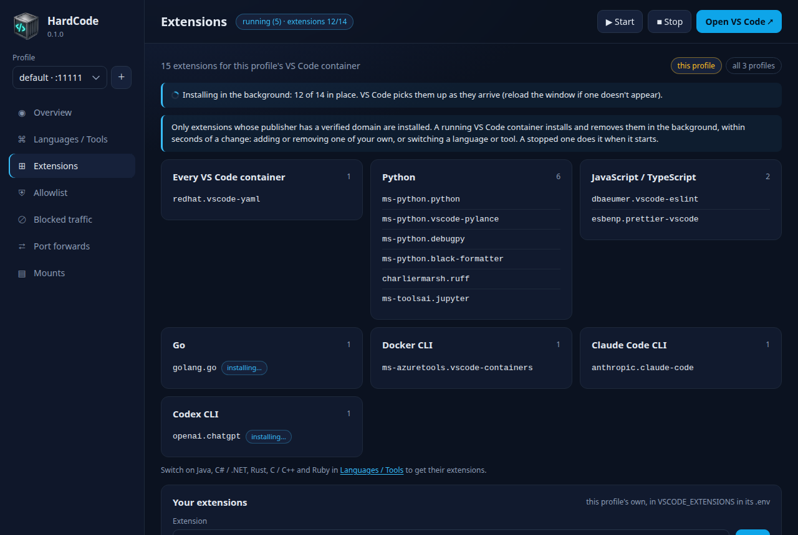

# Inside the sandbox

Each profile's sandbox is a Linux container, built from Ubuntu 26.04, in
which VS Code runs with the languages and tools you chose. This page says
what is in it, what is kept when it restarts and what isn't, how the coding
agents are set up, and how to use Docker inside it.

## What every sandbox has

- **You are the user `dev`**, with `sudo` that needs no password. Inside
  the sandbox you can install and change anything; the boundary is the
  container and its network, not the user account.
- **VS Code**, in your browser, with the YAML extension.
- **Everyday tools**: git (with git-lfs), GitHub's `gh`, an SSH client,
  `curl`, `wget`, `jq`, `ripgrep`, `fdfind`, `shellcheck`, `vim`, `nano`,
  `tmux`, `htop`, `zip`, `rsync`, `man`, and the like.

## Languages and tools

A profile's languages and tools decide three things: what its image
installs, which [allowlist entries](allowlist.md#what-hardcode-provides)
are open, and which VS Code extensions it gets.

| Key | Name | Installs | VS Code extensions |
|---|---|---|---|
| `python` | Python | Python 3.14, pip, venv, pipx, black; uv and ruff | `ms-python.python`, `ms-python.vscode-pylance`, `ms-python.debugpy`, `ms-python.black-formatter`, `charliermarsh.ruff`, `ms-toolsai.jupyter` |
| `node` | JavaScript / TypeScript | Node.js 22, npm, yarn, TypeScript; pnpm | `dbaeumer.vscode-eslint`, `esbenp.prettier-vscode` |
| `java` | Java | OpenJDK 25, Maven; Gradle | `vscjava.vscode-java-pack` |
| `android` | Android | OpenJDK 21, sdkmanager; the Android SDK goes in your home ([below](#android)) | `jetbrains.kotlin-server`, `vscjava.vscode-java-pack` |
| `dotnet` | C# / .NET | .NET SDK 10 | `ms-dotnettools.csdevkit`, `ms-dotnettools.csharp` |
| `go` | Go | Go 1.26, gopls, delve, Go's extra tools | `golang.go` |
| `rust` | Rust | rustc, cargo, rustfmt, clippy, rust-src, rust-gdb, rust-lldb | `rust-lang.rust-analyzer`, `vadimcn.vscode-lldb` |
| `cpp` | C / C++ | GCC 15, Clang 21 with clangd, clang-format and clang-tidy, LLDB, GDB, lld, CMake, Ninja, ccache, Valgrind, cppcheck, bear | `ms-vscode.cpptools`, `ms-vscode.cmake-tools`, `ms-vscode.makefile-tools` |
| `ruby` | Ruby | Ruby 3.3, bundler | `shopify.ruby-lsp` |
| `perl` | Perl | Perl 5.40, cpanminus, local::lib, perltidy, Perl::Critic | |
| `build_essentials` | Build essentials (tool) | gcc and g++, make, autotools, pkg-config, gettext, common development libraries (OpenSSL, zlib, libffi, SQLite, readline, …) | |
| `docker` | Docker CLI (tool) | `docker`, buildx, compose, which talk to the profile's own Docker daemon | `ms-azuretools.vscode-containers` |
| `kubernetes` | Kubernetes (tool) | `kubectl`, `helm`, `kind` ([below](#kubernetes)) | `ms-kubernetes-tools.vscode-kubernetes-tools` |
| `claude_cli` | Claude Code CLI (tool) | `claude`: Anthropic's coding agent | `anthropic.claude-code` |
| `codex_cli` | Codex CLI (tool) | `codex`: OpenAI's coding agent | `openai.chatgpt` |

To switch one on or off, use the switch on the app's **Languages / Tools**
page, or:

```sh
hardcode enable rust          # on, and the image rebuilt now
hardcode disable java dotnet  # off, and the image rebuilt now
hardcode enable go --no-build # on; the image is rebuilt later, with hardcode rebuild
hardcode languages            # every language and tool, on or off, and whether the image has it
```

The keys above work, and so do short names: `js`, `ts`, `c++`, `c#`,
`golang`, `k8s`, `claude`, `codex`, `build`.

A switch changes things at different times. The allowlist entries open or
close at once (a running proxy reloads). The extensions follow within
seconds, while VS Code runs. The software itself comes with the next image
rebuild, which takes a few minutes: the app marks a language *not in the
image yet* or *still in the image* until then, with a **Rebuild image**
button.

## What is kept, and what isn't

| Where, inside the sandbox | Kept in | Lasts |
|---|---|---|
| `/home/dev`, your home folder | the profile's home storage | through stops, restarts and rebuilds. VS Code's server and extensions, Claude Code, your settings, caches and sign-ins are here. |
| `/shared` (also `~/shared`) | the profile's shared storage | through stops, restarts and rebuilds. The Docker daemon sees it too, so `docker run -v /shared/...` works. |
| shared folders (mounts) | your computer | they are your folders: changes made in the sandbox are made on your computer. |
| images and containers made with Docker inside | the Docker daemon's own storage | through stops, restarts and rebuilds. |
| everything else (`/usr`, `/etc`, `/opt`, ...) | the container | until the container is recreated: a rebuild, a change of shared folders, Docker switched on or off, `hardcode down`. A `sudo apt install` goes with it. |

**Reset…** in the app (`hardcode down -v`) deletes all the storage above
that isn't your computer's: the home folder, `/shared` and Docker's data.
**Delete profile…** deletes it with the profile.

Software you install for yourself lands in your home folder, and lasts:
`pipx install`, Python virtual environments in your folders, `npm install
-g` (into `~/.local`), `cargo install` (`~/.cargo`), `go install` (`~/go`),
`gem install` (`~/.gem`), `cpanm` (`~/perl5`). Their folders are on the
`PATH`.

A Go project whose `go.mod` asks for a newer Go than the image's gets it
too: `go` downloads that toolchain from Go's module proxy, checks it
against Go's checksum database, and keeps it in `~/go`. Go's
[allowlist block](allowlist.md#what-hardcode-provides) opens both.

## VS Code and its extensions

VS Code's server updates itself as it runs, inside your home folder (the
image only provides the first one), and its telemetry is off. It opens
your home folder unless the address names another, or the profile's
`VSCODE_DEFAULT_FOLDER` setting does.

The extensions aren't in the image either. A profile's sandbox installs
them, in the background, from the profile's list:

- the one every sandbox has (YAML);
- those of its languages and tools (see the table above);
- the profile's own: add one with the app's **Extensions** page or
  `hardcode extension add publisher.name`, using the id the Marketplace
  shows on the extension's page.



A change reaches a running sandbox within seconds, with no restart; VS
Code picks a new extension up as it arrives (reload the browser window if
one doesn't appear). `hardcode extensions` and the app's **Extensions**
page show how far the installing has got.

**Only extensions from publishers whose domain the Marketplace has
verified are installed**, and only when everything they pull in (their
dependencies, a pack's members) passes the same check. An extension that
doesn't is refused and shown as such. The one reviewed exception is
CodeLLDB (`vadimcn.vscode-lldb`), the Rust debugger that VS Code's own
Rust documentation recommends. Add extensions through HardCode rather than
VS Code's own Extensions view: only HardCode's list is checked. (HardCode
leaves extensions you install or uninstall in VS Code itself alone.)

## Claude Code

`claude` is in the terminal, and the Claude Code extension in VS Code,
when the profile has the **Claude Code CLI** tool. Type `claude` and sign
in as it asks; the sign-in is kept in your home folder.

- **Its telemetry and error reporting are off**, and their hosts aren't on
  the allowlist. The connectors from your claude.ai account are off too,
  and the host they go through is closed.
- **Its own hosts** (the API, sign-in, its downloads and updates) are the
  Claude Code CLI's allowlist block. Switching the tool off closes them and
  removes the extension.
- **It keeps itself up to date**, from its own download host.
- **Anything else it needs to reach**, such as an MCP server or a plugin
  marketplace, needs an allowlist entry of its own. Claude Code's
  official plugin marketplace is a GitHub repository:
  `github.com/anthropics/claude-code`.

## Codex

`codex` is in the terminal, and its extension in VS Code, when the profile
has the **Codex CLI** tool. Its allowlist block opens what it needs, all
`rw`, since each is an API: `auth.openai.com` (sign-in),
`chatgpt.com/backend-api` (the model, with a ChatGPT plan) and
`api.openai.com` (the model, with an API key). Its update check, metrics
and crash reports stay closed.

- **Signing in.** Codex's usual browser sign-in calls back to an address
  inside the sandbox that your browser can't reach. Use
  `codex login --device-auth` instead (switch device code login on in your
  ChatGPT security settings first), or an API key:
  `printenv OPENAI_API_KEY | codex login --with-api-key`. Its credentials
  are kept in `~/.codex`, in your home folder.
- **Its first configuration.** The first time the sandbox starts, it
  writes `~/.codex/config.toml`: the update check, analytics, feedback
  uploads and metrics off, and `sandbox_mode = "danger-full-access"`.
  Codex's own sandbox needs something this container doesn't allow (user
  namespaces), so every command it ran would fail; the container, its
  proxy and its network are the sandbox here, as they are for Claude Code.
  Codex still asks before acting, as its approval policy says. The file is
  yours to change afterwards.
- **Updating.** Codex comes with the image: rebuild to update it, and set
  `CODEX_VERSION` in the profile's `.env` to stay on one release.
- **Its connections.** The proxy doesn't pass WebSocket connections, so
  Codex uses HTTPS instead, as it is built to.

## Android

With **Android**, the image has OpenJDK 21 and `sdkmanager`. The Android
SDK itself goes into your home folder, `~/Android/Sdk` (`ANDROID_HOME`),
where it lasts.

1. **Accept Google's licences**, once: `sdkmanager --licenses` shows them
   and asks. They are yours to accept, so HardCode doesn't accept them for
   you.
2. **Build**: `./gradlew assembleDebug`. Android's Gradle plugin downloads
   the SDK platforms and build tools the project needs. To install a
   package yourself: `sdkmanager --install "platform-tools"`. This
   `sdkmanager` is F-Droid's, from Ubuntu, and checks every package
   against F-Droid's public log of the SDK's checksums.

- **JDK 21 is the default `java`**, with Java on as well (its JDK 25 stays
  in `/usr/lib/jvm`): the Gradle 8 that most Android projects' wrappers
  name can't run on JDK 25.
- **Kotlin by JetBrains** gives VS Code Kotlin's completion, errors and
  navigation. It is an alpha, and its Android support experimental. Its
  `intellij.dataSharing` setting decides what it would send JetBrains; the
  allowlist doesn't open JetBrains' hosts.
- **Running the app is for your computer.** The sandbox has no hardware
  virtualisation for the emulator, and can't reach USB devices or your
  network, so neither an emulator nor a phone works from inside it. Keep
  the project in a [shared folder](#what-is-kept-and-what-isnt), build it
  here, and install it from your computer:
  `adb install app/build/outputs/apk/debug/app-debug.apk`.

## Using Docker inside the sandbox

With the **Docker CLI** tool, `docker`, `docker compose` and `docker
buildx` talk to the profile's own Docker daemon, which runs beside VS Code
in a container of its own, without root. Its containers are behind the
same allowlist as everything else. A profile that doesn't need containers
can do without it: `hardcode docker off`, or the switch on the **docker**
row of the app's Overview.

- **Folders you mount into containers** must exist where the daemon runs:
  `/shared`, and the folders shared with `hardcode mount` (which are
  shared with both). `docker run -v ~/git/project:/src …` works for a
  mounted `~/git`; a folder that exists only in VS Code's container
  doesn't.
- **File ownership**: you (`dev`) appear as `root` inside containers, and
  files containers create appear as yours.
- **Published ports** are on the daemon's container: `docker run -p
  8080:80` is reachable from VS Code's terminal as `http://docker:8080`,
  and from your browser after `hardcode forward 8080 docker`.
- **The proxy**: containers and builds are given the proxy settings
  automatically (in `~/.docker/config.json`). They have no other way out.
- **HTTPS inside containers** fails unless the container trusts the
  proxy's certificate, because the proxy decrypts HTTPS to check it. The
  certificate is at `/proxy-ca`, both in VS Code's container and where the
  daemon runs:

  ```sh
  docker run -v /proxy-ca:/proxy-ca:ro -e SSL_CERT_FILE=/proxy-ca/ca-bundle.pem …   # Go, OpenSSL, curl, apk, Ruby, .NET
  docker run -v /proxy-ca:/proxy-ca:ro -e NODE_EXTRA_CA_CERTS=/proxy-ca/ca.pem …     # Node (npm, yarn)
  ```

  For `RUN` steps in an image build, copy `/proxy-ca/ca.pem` into the
  build's folder, and in the Dockerfile:

  ```dockerfile
  COPY ca.pem /etc/proxy-ca.pem
  ENV SSL_CERT_FILE=/etc/proxy-ca.pem NODE_EXTRA_CA_CERTS=/etc/proxy-ca.pem PIP_CERT=/etc/proxy-ca.pem
  ```

  Plain-HTTP package mirrors such as `deb.debian.org` need nothing.
- **Pushing images isn't possible**: the container registries are
  read-only on the allowlist.
- **Testcontainers** works: `TESTCONTAINERS_HOST_OVERRIDE=docker` is set.

## Kubernetes

With the **Kubernetes** tool, the image has `kubectl`, `helm` and `kind`,
each its project's newest release when the image was built, and VS Code
has Microsoft's Kubernetes extension, for manifests, Helm charts and the
clusters kubectl knows.

- **Manifests and charts** need nothing more: `kubectl kustomize`, `helm
  template`, `helm lint`, `helm package`, and charts pulled from the
  container registries every profile has (`helm pull
  oci://registry-1.docker.io/…`, `ghcr.io`). A chart repository on a site
  of its own (`helm repo add`) needs an [entry of yours](allowlist.md) for
  that site.
- **A cluster of yours** is reached through the proxy, like everything
  else, so its API server needs an entry of yours too: `hardcode allow
  k8s.example.com rw` (`rw`, as kubectl makes changes with `POST`, `PUT`,
  `PATCH` and `DELETE`; read-only is enough for `get`, `describe` and
  `logs`). The Kubernetes block never opens one. The proxy looks inside
  HTTPS, which narrows what it can reach: an API server on port 443, with
  a certificate from a public certificate authority, and a kubeconfig that
  signs in with a token rather than a client certificate and leaves out
  the cluster's `certificate-authority-data`, so that kubectl trusts the
  system's certificates, the proxy's among them. Most managed clusters'
  API servers have a certificate from the cluster's own authority, which
  the proxy refuses. `kubectl exec`, `attach`, `cp` and `port-forward`
  don't work through the proxy: they need connections it doesn't pass.
- **kind can't start a cluster here.** Its nodes would be containers of
  the profile's Docker daemon, which runs rootless and without cgroups
  (`docker info` says `Cgroup Driver: none`), and kind refuses such a
  daemon.
- **The extension** uses the image's `kubectl` and `helm`. Its
  `vs-kubernetes.kubectlVersioning` setting, `user-provided` unless you
  change it, keeps it that way; `infer` has it download a kubectl to
  match each cluster into your home folder, from `dl.k8s.io`, which the
  Kubernetes block opens.
- **Updating.** kubectl, Helm and kind come with the image: rebuild to
  update them, and set `KUBECTL_VERSION`, `HELM_VERSION` and
  `KIND_VERSION` in the profile's `.env` to stay on one release.

## Rebuilding and updating

```sh
hardcode rebuild    # rebuild the image with the profile's languages and tools; your home folder is kept
hardcode down -v    # start afresh next time: a new home folder (extensions, settings, caches, sign-ins gone)
```

In the app, **Rebuild image** on the Languages / Tools page rebuilds VS
Code's image; **Rebuild images** on the Overview rebuilds all of the
profile's images and starts it again.

A profile's image is built once and then kept, even when you update
HardCode: rebuild each profile after an update to get the newer image.
Only the steps after the first one that changed run again, so a rebuild is
usually quicker than the first build. To run every step again, with the
newest packages from the Ubuntu archive:

```sh
hardcode compose build --no-cache vscode
hardcode up
```

## Reference

### Where the image's software comes from

Ubuntu 26.04's own packages first. Other sources only where Ubuntu has
nothing usable:

| From elsewhere | Why |
|---|---|
| VS Code (Microsoft's package, checksum-checked; it isn't allowed to add Microsoft's package repository) | not in Ubuntu |
| uv, ruff (from PyPI, with pipx, into `/opt/pipx`) | not in Ubuntu |
| pnpm (from npm) | not in Ubuntu; its corepack is too old |
| Gradle (from gradle.org, checksum-checked; `GRADLE_VERSION`) | Ubuntu's 4.4.1 can't run on JDK 25 |
| kubectl (from dl.k8s.io, checksum-checked; `KUBECTL_VERSION`) | not in Ubuntu |
| Helm (from get.helm.sh, checksum-checked; `HELM_VERSION`) | not in Ubuntu |
| kind (its release on GitHub, checked against the checksum published with it; `KIND_VERSION`) | Ubuntu's 0.30.0 makes Kubernetes 1.34 clusters, and kubectl supports clusters at most one minor version from its own |
| Claude Code CLI (Anthropic's installer, from claude.ai) | not in Ubuntu |
| Codex CLI (OpenAI's release on GitHub, checked against the checksum GitHub publishes; `CODEX_VERSION`) | not in Ubuntu |

The image records the languages and tools it was built with (in its
`io.github.hardcode-app.languages` label), which `hardcode languages` and
the app compare with the profile's to say when a rebuild is due.

### What the container does as it starts

1. Takes ownership of the home folder and `/shared` if they were created
   as root's.
2. Makes the Android SDK's folder in the home, when the image has Android,
   and the sandbox's own SSH key, when the home has none: an ed25519 key,
   `~/.ssh/id_ed25519`, without a passphrase. Its log says so, once; `cat
   ~/.ssh/id_ed25519.pub` shows the public half to add to a git host
   ([staying safe](staying-safe.md#keep-secrets-out-of-the-sandbox) says
   how). A home with a key already keeps it.
3. Adds the proxy's certificate to the system's trusted certificates
   (which also refreshes Java's). For tools that keep their own, the
   container's environment points `SSL_CERT_FILE`, `REQUESTS_CA_BUNDLE`,
   `PIP_CERT` and `CODEX_CA_CERTIFICATE` at the system's bundle, and
   `NODE_EXTRA_CA_CERTS` at the proxy's certificate.
4. Sets the proxy up for tools that ignore `HTTP(S)_PROXY`: apt, SSH (only
   to hosts with an `ssh` entry), the Docker CLI (`~/.docker/config.json`,
   which also passes the proxy to every container and build it starts),
   Maven (`~/.m2/settings.xml`) and Gradle (`~/.gradle/gradle.properties`).
   The files in your home folder are only written when missing, so your
   own edits win; delete one to have it written again. Codex's first
   configuration is written the same way.
5. Starts installing the profile's extensions in the background, and
   keeps following the list.
6. Starts VS Code. Its token is never written to the container's log:
   `hardcode open` gives the address with it.

### The extensions' progress

The sandbox writes how far it has got with the extensions to
`~/.vscode-server/.hardcode-extensions-status.json` (`installing` or
`done`, how many of how many are in place, and which are pending, refused
or to be tried again), which `hardcode extensions` and the app read, and
to the container's log, one line per step, which the Kubernetes admin UI
reads. An extension that couldn't be installed or checked (the
Marketplace didn't answer within 30 seconds) is removed and tried again a
minute later. One that is refused is remembered, and not asked about
again.
