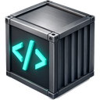

# HardCode on Kubernetes



An **operator** turns `Profile` objects into sandboxes, and an **admin UI**
(email + password + authenticator app) lets a team manage them. Both run in
one small Deployment from the `hardcode-admin` image.

```
kind: Profile                         what the operator builds from it
apiVersion: hardcode-app.github.io/v1alpha1
metadata: { name: team-a }            team-a-vscode     StatefulSet (VS Code + rootless Docker) + Service [+ Ingress]
spec:                                 team-a-squid      Deployment + Service: inspecting proxy
  languages: [python, docker]         team-a-coredns    Deployment + Service: filtering DNS (VS Code's only nameserver)
  extensions: [eamodio.gitlens]       team-a-allowlist  ConfigMap, rendered by an init container in both
  allowlist: |                        team-a-vscode-extensions ConfigMap: the extensions VS Code installs as it runs
    api.anthropic.com   rw            team-a-proxy-ca   Secret (CA key + cert, generated once) + a ConfigMap with the cert
    github.com/team-a                 team-a-vscode-token Secret
  image: reg.example.com/vscode:1.0   three NetworkPolicies: the VS Code pod can reach squid and that DNS, nothing else
  vscodeHost: a.code.example.com
```

A profile's **languages and tools** come first: they decide which package
registries its allowlist opens (a block per language) and which VS Code
extensions the VS Code container installs, beside `extensions` of its own,
in the background and without a restart. The image decides which toolchains
exist; the default image has them all.

Everything a profile owns carries an owner reference, so deleting the
Profile deletes all of it, volumes included (the StatefulSet's PVC retention
policy). Each profile gets its own CA, token, DNS ClusterIP (allocated by
Kubernetes and fed back into the pod's `dnsConfig`) and allowlist, so
profiles are isolated from each other and can run different images.

| Compose stack | Chart |
|---|---|
| `profiles/<name>/` (.env, allowlist.txt, override) | a `Profile` object: `spec.languages`, `spec.extensions`, `spec.allowlist`, `spec.image`, sizes, mounts |
| `hardcode enable/disable <lang>`, `hardcode extension add` | the **Languages / Tools** and **Extensions** tabs, or a patch to `spec.languages` / `spec.extensions` |
| `hardcode -p name up` | the operator, as soon as the Profile exists |
| `hardcode --all allow …` | **All allowlists** in the admin UI, or `POST /api/allowlist/bulk` |
| `hardcode mount` | `spec.extraVolumes` + `spec.extraVolumeMounts` (PVCs), applied to vscode and docker |
| `hardcode forward` | `kubectl port-forward` to the VS Code container pod |
| the gateway | `vscodeHost` → an Ingress per profile, or `kubectl port-forward` |

## Requirements

- A CNI that **enforces NetworkPolicy** (Calico, Cilium, Antrea, …). Without
  it the VS Code container has normal pod networking and the allowlist only applies to
  traffic that chooses to use the proxy.
- A node that allows a **privileged container** for the rootless Docker
  sidecar (`profileDefaults.docker.privileged`), or `docker.enabled: false`.
- A **registry** the cluster can pull `vscode`, `hardcode-squid` and
  `hardcode-admin` from.
- An Ingress controller if you want VS Code and the admin UI reachable without
  port-forwards. Put TLS in front of both; the admin UI's session cookie is
  marked `Secure` when it sees `X-Forwarded-Proto: https`.

## Install

Build and push the images (the VS Code image is about 12 GB):

```sh
hardcode build
docker build -f images/admin/Dockerfile -t hardcode-admin .
for i in hardcode-vscode:default hardcode-squid:latest hardcode-admin:latest; do
  docker tag $i registry.example.com/hardcode/${i%%:*}:1.0 && docker push registry.example.com/hardcode/${i%%:*}:1.0
done
```

```sh
helm upgrade --install hardcode helm/hardcode -n sandbox --create-namespace \
  --set admin.email=you@example.com --set admin.password='a long bootstrap password' \
  --set admin.image.repository=registry.example.com/hardcode/hardcode-admin --set admin.image.tag=1.0 \
  --set profileDefaults.image=registry.example.com/hardcode/vscode:1.0 \
  --set profileDefaults.squidImage=registry.example.com/hardcode/hardcode-squid:1.0 \
  --set 'profiles[0].name=default' --set-file 'profiles[0].allowlist=template/allowlist.txt'
```

Then (the chart's notes repeat this): port-forward or Ingress to the admin
service, sign in with the bootstrap admin, scan the QR code with your
authenticator app, and you're in. The bootstrap account is only used when no
admins exist yet; add the rest from the **Admins** page. Accounts (scrypt
password hashes and TOTP secrets) live in the `hardcode-admin-users` Secret;
sessions are in memory.

## The admin UI

- **Profiles**: status, languages, image, allowlist size; create (choosing
  its languages first, from the template or as a copy of another profile,
  with an optional image and VS Code host), open one.
- **A profile**: its languages (what each opens and brings), its extensions
  (the languages' and its own), its allowlist (toggle, add, delete, or edit
  as text), blocked traffic from its squid and CoreDNS pods with one-click
  allow, the VS Code URL and token, settings (image, host, volume size,
  Docker sidecar, suspend), delete.
- **All allowlists**: add, remove, enable or disable an entry in every profile
  at once, with a per-profile result.
- **Admins**: add, remove, reset someone's 2FA.

Every change is a patch to the Profile object; the operator applies it within
seconds (squid and CoreDNS restart on an allowlist change). `kubectl` works
just as well: `kubectl edit profile team-a`.

## Values

See [values.yaml](hardcode/values.yaml); every key is commented. The main
ones: `admin.email`/`admin.password` (or `admin.existingSecret`),
`admin.image`, `admin.ingress`, `profileDefaults.*` (images, sizes, docker,
network policy, Ingress class for profiles with a `vscodeHost`), and
`profiles[]` to create profiles with the chart.

## Tests

`tests/helm.py` lints and renders the chart; `tests/admin.py` runs the
operator and the API against an in-memory Kubernetes API; `tests/e2e_kind.py`
installs the chart on a local kind cluster, signs in with TOTP through the
API, and checks the operator builds, changes and deletes profiles for real
(squid and CoreDNS pods come up; the VS Code image isn't loaded, so those pods
stay Pending).

The full documentation is in [docs/kubernetes.md](../docs/kubernetes.md) (chart, CRD, operator) and [docs/admin.md](../docs/admin.md) (UI with screenshots, API).
